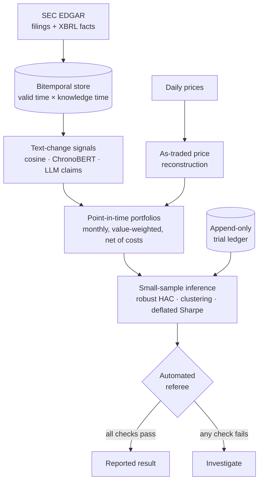
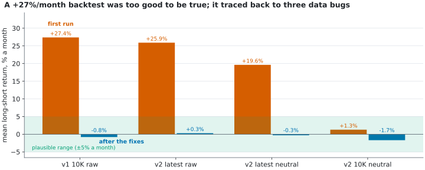
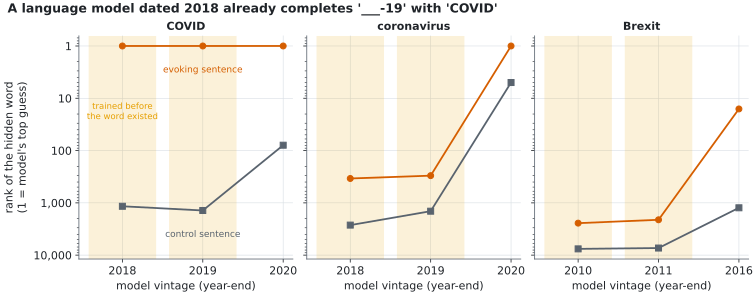
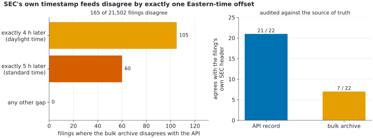
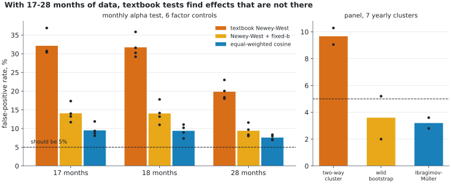

<div align="center">

# Filing Time Machine

**Do changes in what companies tell the SEC predict their stock returns?<br>
And can we answer that without the backtest quietly peeking at the future?**

[](https://github.com/nicholas-yi/chronoledger/actions/workflows/tests.yml)


</div>

<picture>
  <source media="(prefers-color-scheme: dark)" srcset="docs/figures/time-machine-dark.svg">
  
</picture>

<sub><b>Figure 1.</b> The core idea. Every number from a filing is stored with two dates: the period it
describes and the moment the SEC accepted it. A backtest asks "what was known <i>as of</i> this
instant?" and gets only that, so a restatement filed in June cannot leak into a trade made in April.
(Illustration, not real data.)</sub>

---

## The problem

Every public company files annual (10-K) and quarterly (10-Q) reports with the SEC. Most of each
report is copied from the previous one. [Cohen, Malloy & Nguyen (2020), *Lazy Prices*](https://dash.harvard.edu/entities/publication/576a041c-19c4-47d8-b28d-2a5ef079f54f),
found that the firms that *do* change their language tend to underperform afterwards: investors
seem to miss the signal in the edits.

Testing ideas like this sounds easy: download filings, download prices, run a backtest. In practice
a backtest can quietly cheat in at least six ways, and each one makes a strategy look better than it is:

| Pitfall | How it sneaks in |
|---|---|
| **Look-ahead in time** | Using a filing before it was public, e.g. treating an 8 p.m. filing as known at that afternoon's close |
| **Restated history** | Databases overwrite numbers when companies amend them, so the past "knows" later corrections |
| **Survivorship** | Free price data mostly covers companies that still exist; the ones that failed quietly vanish |
| **Split-adjusted prices** | Vendors rescale old prices for later stock splits, so a $5 price filter uses future information |
| **Model memory** | A language model trained on later text can "know" events that had not happened yet |
| **Too many tries** | Test enough variants and one will look significant by luck |

**This project builds a research engine where those mistakes are structurally hard to make, and
tests for them automatically where they are not.** The signal question is the motivating
application; the infrastructure for answering it honestly is the main contribution.

## Approach



### 1. Every fact gets two clocks

Facts from SEC XBRL data carry a **valid time** (the fiscal period described) and a **knowledge
time** (when EDGAR accepted the filing, in UTC). Research code reads facts through `as_of(t)`
queries that return only what was public at instant `t`. Amendments are stored as new rows, never
overwrites, so history cannot be rewritten after the fact.

A signal becomes tradable at the **first 16:00 ET market close strictly after acceptance**. A filing
accepted at 4:01 p.m. waits for the next day.

### 2. Prices as they actually traded

Free price vendors adjust all history for every later stock split. Left alone, a stock that later
split 10-for-1 appears to have traded at a tenth of its real price, which corrupts price filters and
market caps. The engine keeps the vendor's later split *events* (never later prices), reverses the
adjustment, and reconstructs the as-traded price. It is verified against the historical record:
Apple's reconstructed 2014-06-06 close matches it exactly.

### 3. Measuring how much a filing changed

Three representations, from simplest to richest:

- **Bag-of-words cosine similarity** between a report and its predecessor (the original *Lazy Prices* measure):

  $$\text{change}_i = 1 - \frac{\mathbf{w}_{i,t}\cdot\mathbf{w}_{i,t-1}}{\lVert\mathbf{w}_{i,t}\rVert\,\lVert\mathbf{w}_{i,t-1}\rVert}$$

- **Chronologically consistent embeddings.** [ChronoBERT](https://arxiv.org/abs/2502.21206) is a family of
  BERT models, each trained only on text up to a given year-end. Each filing is embedded with the latest
  vintage *strictly before* its acceptance date.
- **Claim-level change.** A local LLM (Qwen 3.5) extracts claims such as "Customer X accounts for
  12% of revenue". Every accepted claim must be backed by a verbatim quote found in the filing, and
  a provenance graph tracks which claims are new, superseded or retracted.

Industry-neutral variants regress each month's scores on two-digit SIC industry, log market cap
and recent acquisitions, then rank the residuals, so that rule changes affecting a whole sector
(new lease accounting, cybersecurity disclosures) are not mistaken for firm-specific news.

### 4. Point-in-time portfolios

At each month-end close:

- Sort firms with a current signal into quintiles.
- Go long the least-changed fifth and short the most-changed fifth.
- Weight by market value: point-in-time XBRL shares outstanding × as-traded price.
- Require a price of at least $5 and a market cap at or above the NYSE 20th-percentile breakpoint.
- Charge transaction costs of 2 × half-spread × turnover, with spreads estimated from daily
  high/low/close prices ([Abdi & Ranaldo 2017](https://alexandria.unisg.ch/entities/publication/734062b6-b25a-46fb-95cf-9f75bfd12ff6/full)).

Portfolio formation is tested to ignore future information: hiding any future return must leave the
holdings unchanged, and an automated test plants exactly that leak to confirm it is caught.

### 5. Statistics built for small samples

- **Pre-registration.** Hypotheses, sample splits and thresholds were fixed in git-tagged documents
  ([v1](docs/PREREGISTRATION.md), [v2](docs/PREREGISTRATION_V2.md)) *before* any return was
  computed. Later changes are logged with timestamps in [DEVIATIONS.md](docs/DEVIATIONS.md).
- **Every trial counts.** Each configuration ever evaluated, including failed and invalid runs, is
  appended to a [trial ledger](results/trial_ledger.jsonl) that feeds the
  [deflated Sharpe ratio](https://www.davidhbailey.com/dhbpapers/deflated-sharpe.pdf) and
  probability-of-backtest-overfitting calculations.
- **High bars.** New signals need |t| ≥ 3.0 ([Harvey, Liu & Zhu 2016](https://people.duke.edu/~charvey/Research/Published_Papers/P118_and_the_cross.PDF)),
  and claim-level results must also hold under a bag-of-words representation that cannot leak
  future information.
- **Tests that hold their size.** With only 17-28 months of data, textbook Newey-West t-tests are badly
  over-confident (see the [test-size simulation](#4-textbook-tests-cry-wolf-with-short-samples) below).
  The engine also implements equal-weighted cosine and fixed-b inference
  ([Lazarus, Lewis, Stock & Watson 2018](https://www.princeton.edu/~mwatson/papers/HAR_Inference_Recommendations_for_Practice.pdf)),
  [Ibragimov-Müller](https://spiral.imperial.ac.uk/entities/publication/651db680-95fd-4163-b596-ae55ddef49aa)
  group tests and the wild cluster bootstrap. Each is checked against hand-derived oracle cases.
- **A sealed holdout.** July 2024 through October 2026 is reserved for one final, single-use test
  and has never been opened.

### 6. An automated referee

[`asof.referee`](src/asof/referee.py) is a skeptical reviewer written as code. It scores each threat
to validity from 1 to 5 and blocks any result unless every gating threat reaches level 4. Many
checks come with a **mutation test**: a deliberately planted bug that the check must catch.

| Threat | Example check |
|---|---|
| Look-ahead in the store | Random as-of queries; a planted period-end leak must be caught |
| Look-ahead in portfolios | Hiding a future return must not change today's holdings |
| Model memory | Every ChronoBERT vintage used must predate the filing; probe for words coined later |
| LLM hallucination | Fabricated partners and invented quotes must be rejected |
| Split-price leakage | A $5 price-filter canary: $1.00 adjusted vs. $28.00 as traded |
| Data integrity | Any long-short mean beyond ±5% a month fails automatically |
| Multiple testing | The deflated Sharpe ratio must reject the best of 500 noise strategies |

The latest [referee report](results/REFEREE.md) records each check's outcome.

## Hypotheses

| | Question | Test |
|---|---|---|
| **H0** | Do firms that change their reports most underperform those that change least? (*Lazy Prices* replication) | Monthly long-short portfolio, FF5 + momentum alpha |
| **H1** | Does claim-level change add information beyond word-level change? | Same portfolio, claim-level score |
| **H2-H3** | Do customer links extracted by an LLM below the 10%-of-revenue disclosure threshold carry return information? Does a customer's change propagate to its suppliers? | Customer-supplier portfolios |
| **H4** | Does text change predict worse fundamentals the next year? | Pooled regression on next-year ROA, earnings declines, goodwill impairments |
| **H5** | Do late-filing notices, auditor changes, restatement warnings and Friday-evening 8-Ks precede negative returns? | Event study, cumulative abnormal returns |
| **H6** | Do quiet downward revisions of prior-year net income predict formal restatements? | Regression with year effects; event study |

## Data

| Source | Used for |
|---|---|
| [SEC EDGAR](https://www.sec.gov/search-filings/edgar-application-programming-interfaces) submissions, full-text filings and XBRL company facts | Filing text, acceptance times, shares outstanding, fundamentals |
| Free daily prices (Yahoo chart API) | Returns, market caps, spread estimates |
| [Kenneth French Data Library](https://mba.tuck.dartmouth.edu/pages/faculty/ken.french/data_library.html) | Fama-French five factors, momentum, NYSE size breakpoints |
| [ChronoBERT](https://arxiv.org/abs/2502.21206) vintages (`manelalab/chrono-bert-v1-YYYYMMDD`) | Time-consistent text embeddings |
| Qwen 3.5 4B / 9B via Ollama, run locally | Claim and relationship extraction |

Raw vendor data stays local and is never redistributed. Only derived statistics are published.

**Scale of the current build:** 32,508 filings with text features · 21,502 consecutive-filing pairs ·
2,733 price histories (14.4 million daily returns) · a 132,527-fact verification store in which
every fact is joined to its filing's acceptance timestamp. The complete four-variant H0 backtest runs in
**61 seconds** from a validated, checksummed price snapshot.

## Results

All results below come from the **development sample** (signals accepted January 2023 to June 2024;
returns through July 2024). They are where methods get debugged, not confirmatory evidence.

### Lazy Prices replication (H0)

<picture>
  <source media="(prefers-color-scheme: dark)" srcset="docs/figures/development-returns-dark.svg">
  
</picture>

<sub><b>Figure 2.</b> Cumulative net return of the long-low-change / short-high-change portfolio for each
signal variant. "v1" compares consecutive 10-Ks; "v2" uses each firm's latest 10-K or 10-Q, compared
with the same period a year earlier. "Neutral" variants first remove industry, size and acquisition effects.
Source: <a href="results/returns_h0_development.json">returns_h0_development.json</a>.</sub>

| Variant | Months | Mean net return / month | Alpha t-stat* |
|---|---:|---:|---:|
| 10-K, raw | 17 | -0.80% | -0.45 |
| Latest filing, raw | 18 | +0.29% | +1.46 |
| Latest filing, neutral | 18 | -0.29% | -2.33 |
| 10-K, neutral | 17 | -1.69% | -2.36 |

**No variant supports the hypothesis.** The two neutral variants even point the wrong way, but
\*at this sample length the textbook t-test shown here flags pure noise as significant about 30% of
the time instead of 5% (Figure 6), so values near ±2.3 are within the range of chance. Missing-return
sensitivities (0%, -30%, -100%) give identical answers because every held stock had a next-month
return.

### Other hypotheses

- **H4, text change → next-year fundamentals (2012-2018).** 2,655 firm-years from a random sample
  of 1,500 companies, including ones later delisted. All six |t| ≤ 1.23: no detectable relationship.
- **H6, quiet revisions → restatements (2012-2018).** Of 22,745 filings, 499 quietly revised the
  prior year's net income downward. Those were followed by a formal amendment or restatement warning
  within a year 17.8% of the time, versus 13.7% for other filings (+4.2 points, t = 1.74). This is
  suggestive but below the pre-set bar of 3.0.
- **H5 and the distress events.** Late-filing notices, auditor changes and restatement warnings
  cannot be tested with free price data. Distressed companies that later delisted are 1.3-3.3× less
  likely to have prices, so the survivors that remain are disproportionately rebounders. All three
  tests showed *positive* returns, the opposite of the published effects, and are reported as
  **invalid**, not as evidence ([F2](docs/FINDINGS.md#f2-distress-event-tests-are-invalid-under-a-current-ticker-universe)).

### LLM extraction benchmark

Fictitious companies are injected into real 10-K text, so the correct answer is known by
construction. A separate test swaps famous real partners for fictitious ones to see whether the model
"remembers" the real partner instead of reading the page.

| | Qwen 3.5 4B (300 cases) | Qwen 3.5 9B (80 cases) | Required |
|---|---:|---:|---:|
| Recall | 0.942 | 0.835 | ≥ 0.80 |
| Precision | 0.956 | 0.981 | ≥ 0.90 |
| Names a partner absent from the text | 0.5% | 0.0% | < 2% |
| Leaks the famous real partner after a swap | 0 / 159 | 0 / 40 | < 2% |

## What the time machine caught

The most useful output so far is a list of ways the analysis would have fooled itself. Each was
caught by a test, a plausibility check or an audit, then fixed and recorded in
[FINDINGS.md](docs/FINDINGS.md).

### 1. A +27%-a-month strategy that was really three bugs

<picture>
  <source media="(prefers-color-scheme: dark)" srcset="docs/figures/caught-bug-dark.svg">
  
</picture>

<sub><b>Figure 3.</b> First recorded run versus the corrected run for each variant, both read from the
append-only trial ledger.</sub>

The first backtest reported alpha t-statistics up to 4.6. No credible text signal earns 27% a month,
so it was treated as a bug until proven otherwise. There were three:

- A company reported **89.8 billion** shares instead of 89.8 million in one filing, which made its
  value weight meaningless. Share-count jumps of more than 10× now take effect only after a later
  filing confirms them.
- Split-adjusted vendor prices made a stock that traded in pennies appear to cost $1,200 (the
  as-traded reconstruction in step 2 fixes this).
- Some monthly returns were below -100%, which is impossible.

The original runs stay in the ledger and still count toward the multiple-testing penalty. A
plausibility check now fails any long-short mean above 5% a month automatically.

### 2. A language model that knew about COVID in 2018

<picture>
  <source media="(prefers-color-scheme: dark)" srcset="docs/figures/leak-probe-dark.svg">
  
</picture>

<sub><b>Figure 4.</b> A masked word is hidden in a sentence that evokes it ("lockdowns in 2020 slowed the
spread of ___-19") and in a control sentence with the same pattern but unrelated meaning ("part number
___-19"). Rank 1 means the model's top guess; the scale is logarithmic. Shaded vintages were trained
before the word was coined. Source: <a href="results/leakprobe_chronobert.json">leakprobe_chronobert.json</a>.</sub>

The 2018 and 2019 ChronoBERT vintages complete the pandemic sentence with "COVID" at 94-98%
probability, yet the same models do not know "coronavirus", and Brexit is clean. The leak is narrow
and context-specific, plausibly from older documents later edited to mention the pandemic. The
vintages this project actually uses (2022-2024) show no such leak in the probe, although the probe
has limited power, and any claim-level result must also hold with a bag-of-words representation
that cannot leak at all.

### 3. The SEC's own clocks disagree

<picture>
  <source media="(prefers-color-scheme: dark)" srcset="docs/figures/timestamps-dark.svg">
  
</picture>

<sub><b>Figure 5.</b> Acceptance times for the same filings from two official SEC JSON sources, and an audit
against each filing's own SGML header. Source: <a href="results/p0_acceptance_authority_audit.json">p0_acceptance_authority_audit.json</a>.</sub>

The engine assumed the SEC's `acceptanceDateTime` field was true UTC, as its `Z` suffix says. A
consistency check found 165 filings whose time differs between the SEC bulk archive and the
per-company API, always by exactly one Eastern-time offset: 4 hours in summer, 5 in winter. Checking
each filing's own header showed the API copy right in 21 of 22 cases, the bulk copy late, and one
filing that both sources got wrong.

Others have since documented the same defect: SEC submission files can be correct, late or early by
one Eastern offset, varying by file and by download date
([edgartools #1501](https://github.com/dgunning/edgartools/issues/1501),
[Canli Capital](https://canlicapital.com/notes/edgar-acceptance-times),
[Gow](https://iangow.github.io/sec_submissions/timestamps/)). For a strategy that trades at the
close, a late timestamp merely delays a signal, but an early one creates look-ahead. Each filing's
own header is the authority, and verifying every filing whose trading day the offset could change
is next on the roadmap.

### 4. Textbook tests cry wolf with short samples

<picture>
  <source media="(prefers-color-scheme: dark)" srcset="docs/figures/test-size-dark.svg">
  
</picture>

<sub><b>Figure 6.</b> Share of simulated datasets with <i>no</i> true effect in which each test reports
significance at the 5% level. Bars are averages over four data-generating processes (normal, AR(1),
fat-tailed t₃, and factor exposure); dots show each process. 2,000 datasets per cell, fixed seed.
Source: <a href="results/robust_inference_calibration.json">robust_inference_calibration.json</a>.</sub>

The monthly test regresses 17-28 returns on six factor controls with Newey-West standard errors, the
standard approach in empirical finance. With so few months, it finds an "effect" in pure noise
**18-37% of the time** instead of 5%. Modern corrections help but do not fully fix it. For the
7-year fundamentals panel, Ibragimov-Müller's year-by-year t-test keeps its size; the textbook
two-way clustered test does not. The practical lesson: with fewer than about 30 independent
periods, a t-statistic near 2 is weak evidence, and more data matters more than a better estimator.

### Also caught

- **Outliers trimmed with future data.** H4 winsorized ratios using the full 2012-2025 sample before
  selecting the 2012-2018 development years, so future observations shaped the development regressors
  ([F4](docs/FINDINGS.md#f4-h4-winsorization-used-observations-outside-development)).
- **Portfolios chosen by the future.** The first portfolio code dropped stocks without a known
  next-month return before ranking, which secretly selects on the outcome
  ([F5](docs/FINDINGS.md#f5-formation-selected-on-future-outcomes-monthly-residuals-were-not-event-time-signals)).
- **Impossible daily returns.** The -100% guard covered monthly but not daily event-study returns
  ([F6](docs/FINDINGS.md#f6-the-f3-price-return-guard-did-not-cover-daily-event-inputs)).

## Limitations

- **Survivorship.** Free price data covers mostly companies that still trade today. Return tests are
  restricted to 2023 onwards, when coverage of large issuers reaches 88-97%, and distress-event tests
  are reported as invalid ([coverage audit](docs/DATA_AUDIT.md#coverage-among-public-equity-issuers-by-public-float)).
- **Short samples, low power.** Assuming 3% monthly volatility, 17-18 development months can only
  reliably detect effects of roughly 2.8-2.9% a month. Anomaly returns typically shrink by more
  than half after publication ([McLean & Pontiff 2016](https://papers.ssrn.com/sol3/papers.cfm?abstract_id=2156623)),
  so a realistic effect would be far smaller.
- **Industry codes are today's.** Industry neutralization uses current SIC codes, not those in force
  at each filing date.
- **Costs are a spread estimate.** Turnover costs use a daily high/low/close proxy; price impact,
  borrow fees and short availability are not modeled.
- **Synthetic extraction labels.** The LLM benchmark's ground truth comes from injected fictitious
  companies, not human annotation.

## Reproduce

```powershell
uv venv --python 3.12
uv pip install -e ".[dev,figures]"
uv run pytest -q                       # 238 tests, no data or network needed
uv run python scripts/make_figures.py  # rebuild every chart from results/
uv run python -m asof.referee          # the automated referee (needs the local data build)
```

Rebuilding the data from SEC EDGAR takes several hours and needs a contact email in
`ASOF_USER_AGENT`, as the SEC requires. Follow the step-by-step
[runbook](docs/DATA_AUDIT.md#data-rebuild-runbook). The package is called `asof`, after the
point-in-time queries everything is built on.

## Repository map

```text
src/asof/
├── store.py            bitemporal fact store and as-of queries
├── edgar.py, bulk.py   rate-limited, cached SEC EDGAR clients
├── prices.py           as-traded price reconstruction
├── sections.py         10-K section parsing and Lazy Prices similarity
├── chrono.py           ChronoBERT vintage selection and embeddings
├── extraction.py       quote-grounded LLM claim extraction
├── reconcile.py        provenance graph: new, superseded and retracted claims
├── backtest.py         point-in-time portfolio formation and costs
├── events.py           event studies and neutralization
├── inference.py        alpha tests, deflated Sharpe, backtest-overfitting probability
├── robust_inference.py small-sample HAC, Ibragimov-Müller, wild cluster bootstrap
├── invariance.py       time-travel invariance harness for look-ahead tests
├── leakprobe.py        language-model neologism probe
├── ledger.py           append-only trial ledger
└── referee.py          the automated referee
scripts/                data builds, study runners, figure generation
docs/                   pre-registration, deviations, findings, data audit
results/                every published number, the trial ledger, the referee report
tests/                  unit, invariance and mutation tests
```

## Roadmap

- [x] Bitemporal store, as-traded prices and look-ahead tests with planted leaks
- [x] Lazy Prices replication on the development sample
- [x] Automated referee and append-only trial ledger
- [x] Small-sample inference checked against simulation and hand-derived oracles
- [ ] Verify every filing's acceptance time against its own SEC header where it matters
- [ ] Survivorship-free prices to open the 2011-2022 periods (≈ 8× more months)
- [ ] Claim-level change signal (H1) with a human-labelled audit set
- [ ] Customer-supplier network signals (H2-H3)
- [ ] One-time evaluation on the sealed July 2024 - October 2026 holdout

## Further reading

- [FINDINGS.md](docs/FINDINGS.md): every finding, including the ones that weaken this project
- [PREREGISTRATION.md](docs/PREREGISTRATION.md) and [DEVIATIONS.md](docs/DEVIATIONS.md): what was
  decided in advance, and every later change
- [DATA_AUDIT.md](docs/DATA_AUDIT.md): data provenance, coverage audits and the rebuild runbook
- [REFEREE.md](results/REFEREE.md): the latest automated referee report

## License

Code is MIT-licensed. SEC data is public. Price data is used for personal research and is not
redistributed; Fama-French factors are cited and linked, not re-hosted.
