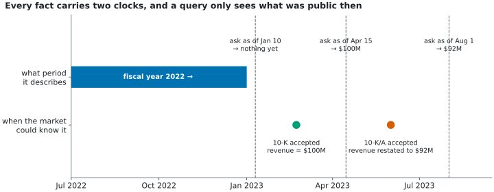
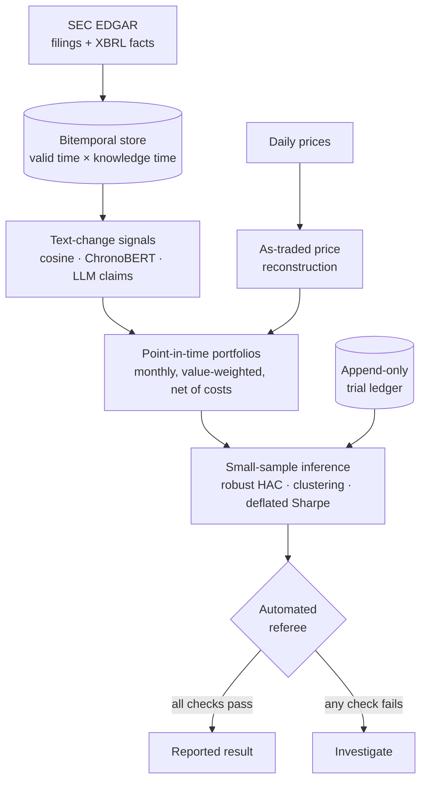
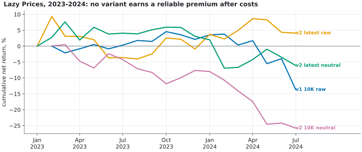
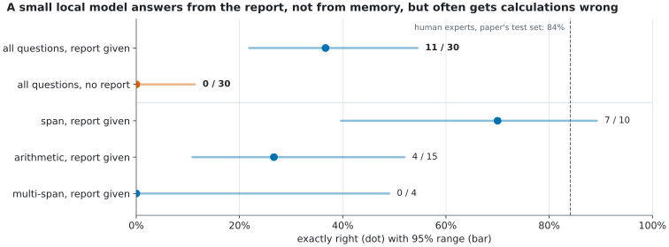

<div align="center">

# Filing Time Machine

**Do changes in what companies tell the SEC predict their stock returns?<br>
And can we answer that without the backtest quietly peeking at the future?**

[](https://github.com/nicholas-yi/chronoledger/actions/workflows/tests.yml)


</div>

<picture>
  <source media="(prefers-color-scheme: dark)" srcset="docs/figures/time-machine-dark.svg">
  
</picture>

<sub><b>Figure 1.</b> The core idea. Every number from a filing is stored with two dates: the period it
describes and the moment the SEC accepted it. A backtest asks "what was known <i>as of</i> this
instant?" and gets only that, so a restatement filed in June cannot leak into a trade made in April.
(Illustration, not real data.)</sub>

---

## The question

Every public company files annual (10-K) and quarterly (10-Q) reports with the SEC, and most of each
report is copied from the previous one. [Cohen, Malloy & Nguyen (2020), *Lazy Prices*](https://dash.harvard.edu/entities/publication/576a041c-19c4-47d8-b28d-2a5ef079f54f),
found that the firms that *do* change their language tend to underperform afterwards: investors seem
to miss the signal in the edits. This project asks whether that still holds, and whether richer
measures of change (what a company *claims*, not just which words it uses) carry more information.

## Why backtests lie

Testing an idea like this looks easy: download filings, download prices, run a backtest. In practice a
backtest can quietly use information nobody had at the time, and every such leak makes a strategy
look better than it is.

| Leak | How it sneaks in |
|---|---|
| **Early information** | Treating an 8 p.m. filing as known at that afternoon's close |
| **Rewritten history** | Databases overwrite numbers when companies amend them, so the past "knows" later corrections |
| **Survivorship** | Free price data mostly covers companies that still exist; the ones that failed quietly vanish |
| **Split-adjusted prices** | Vendors rescale old prices for later stock splits, so a $5 price filter uses future information |
| **Model memory** | A language model trained on later text can "know" events that had not happened yet |
| **Too many tries** | Test enough variants and one will look significant by luck |

The engine is designed so that these leaks are structurally hard to introduce, and so that each one
is checked by code rather than assumed away.

## Inside the engine



<details open>
<summary><b>Two clocks per fact</b></summary>

Facts from SEC XBRL data carry a **valid time** (the fiscal period described) and a **knowledge
time** (when EDGAR accepted the filing, in UTC). Research code reads facts through `as_of(t)`
queries that return only what was public at instant `t`. Amendments are stored as new rows, never
overwrites, so history cannot be rewritten after the fact.

A signal becomes tradable at the **first 16:00 ET market close strictly after acceptance**: a filing
accepted at 4:01 p.m. waits for the next day.
</details>

<details open>
<summary><b>Prices as they actually traded</b></summary>

Free price vendors adjust all history for every later stock split. Left alone, a stock that later
split 10-for-1 appears to have traded at a tenth of its real price, which corrupts price filters and
market caps. The engine keeps the vendor's later split *events* (never later prices), reverses the
adjustment, and reconstructs the as-traded price. Apple's reconstructed 2014-06-06 close matches the
historical record exactly.
</details>

<details open>
<summary><b>Three ways to measure change</b></summary>

- **Bag-of-words cosine similarity** between a report and its predecessor (the original *Lazy Prices* measure):

  $$\text{change}_i = 1 - \frac{\mathbf{w}_{i,t}\cdot\mathbf{w}_{i,t-1}}{\lVert\mathbf{w}_{i,t}\rVert\,\lVert\mathbf{w}_{i,t-1}\rVert}$$

- **Chronologically consistent embeddings.** [ChronoBERT](https://arxiv.org/abs/2502.21206) is a
  family of BERT models, each trained only on text up to a given year-end. Each filing is embedded
  with the latest vintage *strictly before* its acceptance date.
- **Claim-level change.** A local LLM (Qwen 3.5) extracts claims such as "Customer X accounts for
  12% of revenue". Every accepted claim must be backed by a verbatim quote found in the filing, and
  a provenance graph tracks which claims are new, superseded or retracted.

Industry-neutral variants regress each month's scores on two-digit SIC industry, log market cap and
recent acquisitions, then rank the residuals, so that rule changes affecting a whole sector (new lease
accounting, cybersecurity disclosures) are not mistaken for firm-specific news.
</details>

<details open>
<summary><b>Portfolios without hindsight</b></summary>

At each month-end close the engine sorts firms with a current signal into fifths, goes long the
least-changed fifth and short the most-changed fifth, and weights by market value (point-in-time
XBRL shares outstanding × as-traded price). Stocks need a price of at least $5 and a market cap at or
above the NYSE 20th-percentile breakpoint. Costs are 2 × half-spread × turnover, with spreads estimated
from daily high/low/close prices ([Abdi & Ranaldo 2017](https://alexandria.unisg.ch/entities/publication/734062b6-b25a-46fb-95cf-9f75bfd12ff6/full)).

Formation is tested to ignore the future: hiding any future return must leave today's holdings
unchanged, and a test plants exactly that leak to confirm it is caught.
</details>

<details open>
<summary><b>Statistics for short samples</b></summary>

- **Decided in advance.** Hypotheses, sample splits and thresholds were fixed in git-tagged documents
  ([v1](docs/PREREGISTRATION.md), [v2](docs/PREREGISTRATION_V2.md)) *before* any return was
  computed. Later changes are logged with timestamps in [DEVIATIONS.md](docs/DEVIATIONS.md).
- **Every trial counts.** Each configuration ever evaluated is appended to a
  [trial ledger](results/trial_ledger.jsonl) that feeds the
  [deflated Sharpe ratio](https://www.davidhbailey.com/dhbpapers/deflated-sharpe.pdf) and
  probability-of-backtest-overfitting calculations.
- **High bars.** New signals need |t| ≥ 3.0 ([Harvey, Liu & Zhu 2016](https://people.duke.edu/~charvey/Research/Published_Papers/P118_and_the_cross.PDF)),
  and claim-level results must also hold under a bag-of-words representation that cannot leak
  future information.
- **Tests that keep their size.** Besides textbook Newey-West, the engine implements
  equal-weighted cosine and fixed-b inference
  ([Lazarus, Lewis, Stock & Watson 2018](https://www.princeton.edu/~mwatson/papers/HAR_Inference_Recommendations_for_Practice.pdf)),
  [Ibragimov-Müller](https://spiral.imperial.ac.uk/entities/publication/651db680-95fd-4163-b596-ae55ddef49aa)
  group tests and the wild cluster bootstrap, each checked against hand-derived reference cases.
- **A sealed holdout.** July 2024 through October 2026 is reserved for one final, single-use test.
</details>

<details open>
<summary><b>An automated referee</b></summary>

[`asof.referee`](src/asof/referee.py) is a skeptical reviewer written as code. It scores each threat
to validity from 1 to 5 and blocks a result unless every gating threat reaches level 4. Many checks
come with a **mutation test**: a deliberately planted leak that the check must catch.

| Threat | Example check |
|---|---|
| Look-ahead in the store | Random as-of queries; a planted period-end leak must be caught |
| Look-ahead in portfolios | Hiding a future return must not change today's holdings |
| Model memory | Every ChronoBERT vintage used must predate the filing; probe for words coined later |
| LLM hallucination | Fabricated partners and invented quotes must be rejected |
| Split-price leakage | A $5 price-filter canary: $1.00 adjusted vs. $28.00 as traded |
| Implausible returns | Any long-short mean beyond ±5% a month fails automatically |
| Multiple testing | The deflated Sharpe ratio must reject the best of 500 noise strategies |

The latest [referee report](results/REFEREE.md) records each check's outcome.
</details>

## Research questions

| | Question | Test |
|---|---|---|
| **H0** | Do firms that change their reports most underperform those that change least? (*Lazy Prices* replication) | Monthly long-short portfolio, FF5 + momentum alpha |
| **H1** | Does claim-level change add information beyond word-level change? | Same portfolio, claim-level score |
| **H2-H3** | Do customer links extracted by an LLM below the 10%-of-revenue disclosure threshold carry return information? Does a customer's change propagate to its suppliers? | Customer-supplier portfolios |
| **H4** | Does text change predict worse fundamentals the next year? | Pooled regression on next-year ROA, earnings declines, goodwill impairments |
| **H5** | Do late-filing notices, auditor changes, restatement warnings and Friday-evening 8-Ks precede negative returns? | Event study, cumulative abnormal returns |
| **H6** | Do quiet downward revisions of prior-year net income predict formal restatements? | Regression with year effects; event study |

## Inputs and how each is kept honest

| Input | Source | Point-in-time treatment |
|---|---|---|
| Filing text, acceptance times, shares, fundamentals | [SEC EDGAR](https://www.sec.gov/search-filings/edgar-application-programming-interfaces) submissions, filings and XBRL company facts | Indexed by acceptance instant; amendments appended, never overwritten |
| Daily prices | Free vendor (Yahoo chart API) | Later split adjustments reversed; nothing after the cutoff is stored |
| Factors and size breakpoints | [Kenneth French Data Library](https://mba.tuck.dartmouth.edu/pages/faculty/ken.french/data_library.html) | Size filter uses the formation month's NYSE breakpoint; factors are used only to evaluate returns |
| Text embeddings | [ChronoBERT](https://arxiv.org/abs/2502.21206) vintages (`manelalab/chrono-bert-v1-YYYYMMDD`) | Latest vintage strictly before the filing |
| Claim extraction | Qwen 3.5 4B / 9B via Ollama, run locally | Reads only the filing; every claim must quote it verbatim |

Raw vendor data stays local and is never redistributed; only derived statistics are published.

**Scale:** 32,508 filings with text features · 21,502 consecutive-filing pairs · 2,733 price
histories (14.4 million daily returns) · a 132,527-fact verification store. The complete
four-variant H0 backtest runs in **61 seconds** from a validated, checksummed price snapshot.

## Results so far

All results come from the **development sample**: signals accepted January 2023 to June 2024, returns
through July 2024. This is where methods are tuned and checked; it is not confirmatory evidence.

### Lazy Prices replication (H0)

<picture>
  <source media="(prefers-color-scheme: dark)" srcset="docs/figures/development-returns-dark.svg">
  
</picture>

<sub><b>Figure 2.</b> Cumulative net return of the long-low-change / short-high-change portfolio for each
signal variant. "v1" compares consecutive 10-Ks; "v2" uses each firm's latest 10-K or 10-Q, compared
with the same period a year earlier. "Neutral" variants first remove industry, size and acquisition effects.
Source: <a href="results/returns_h0_development.json">returns_h0_development.json</a>.</sub>

| Variant | Months | Mean net return / month | Alpha t-stat* |
|---|---:|---:|---:|
| 10-K, raw | 17 | -0.80% | -0.45 |
| Latest filing, raw | 18 | +0.29% | +1.46 |
| Latest filing, neutral | 18 | -0.29% | -2.33 |
| 10-K, neutral | 17 | -1.69% | -2.36 |

**No variant supports the hypothesis.** The two neutral variants even point the wrong way, but
\*at this sample length the textbook t-test shown here flags pure noise as significant about 30% of
the time instead of 5% (Figure 6), so values near ±2.3 are within the range of chance. Missing-return
sensitivities (0%, -30%, -100%) give identical answers because every held stock had a next-month
return.

### Other hypotheses

- **H4, text change → next-year fundamentals (2012-2018).** 2,655 firm-years from a random sample
  of 1,500 companies, including ones later delisted. All six |t| ≤ 1.23: no detectable relationship.
- **H6, quiet revisions → restatements (2012-2018).** Of 22,745 filings, 499 quietly revised the
  prior year's net income downward. Those were followed by a formal amendment or restatement warning
  within a year 17.8% of the time, versus 13.7% for other filings (+4.2 points, t = 1.74):
  suggestive, but below the pre-set bar of 3.0.
- **H5, distress events.** Late-filing notices, auditor changes and restatement warnings cannot be
  tested with free price data: distressed companies that later delisted are 1.3-3.3× less likely to
  have prices, so the remaining sample is tilted toward survivors. These tests are reported as
  invalid rather than as evidence ([coverage analysis](docs/FINDINGS.md#f2-distress-event-tests-are-invalid-under-a-current-ticker-universe)).
- **H1-H3** (claim-level and customer-supplier signals) have not been evaluated on returns yet.

### LLM extraction benchmark

Fictitious companies are injected into real 10-K text, so the correct answer is known by
construction. A second test swaps famous real partners for fictitious ones to see whether the model
"remembers" the real partner instead of reading the page.

| | Qwen 3.5 4B (300 cases) | Qwen 3.5 9B (80 cases) | Required |
|---|---:|---:|---:|
| Recall | 0.942 | 0.835 | ≥ 0.80 |
| Precision | 0.956 | 0.981 | ≥ 0.90 |
| Names a partner absent from the text | 0.5% | 0.0% | < 2% |
| Leaks the famous real partner after a swap | 0 / 159 | 0 / 40 | < 2% |

### Reading real financial reports

The benchmark above uses invented companies. On real reports, the test is
[TAT-QA](https://github.com/NExTplusplus/TAT-QA): questions about tables and text from real annual
reports, with answers written by finance-trained annotators. The local Qwen 3.5 4B model answered
30 randomly drawn development questions twice, once with the report and once without it.

<picture>
  <source media="(prefers-color-scheme: dark)" srcset="docs/figures/reader-accuracy-dark.svg">
  
</picture>

<sub><b>Figure 3.</b> Share of questions answered exactly right (dots) with 95% ranges (bars). One
counting question is not shown. The dashed line is the human-expert score reported by the
<a href="https://arxiv.org/html/2105.07624v2#S4.T3">TAT-QA paper</a> on its own test set, shown for
scale rather than as a matched comparison. Source:
<a href="results/reader_real2_combined.json">reader_real2_combined.json</a>.</sub>

- **It answered only when supplied the report.** Without it the model declined all 30
  questions. With it the model answered every one, 11 exactly right (37%, 95% range 22-54%).
  Abstention alone does not establish whether the public questions were in its training data.
- **Lookup scores were higher in this sample.** It got 7 of 10 single-value lookups right, but
  only 4 of 15 calculations and none of the 4 questions needing several values. Units were
  right 73% of the time. The [offline error review](results/reader_error_audit.json) separates
  representation, units, calculations and reference ambiguity without changing any score.
- **The test was fixed before any answer.** The 30 questions, the prompt and the scoring were
  committed first. A first version declined everything until it was asked for the answer before
  the option to decline; 12 invented questions confirmed that change worked. The final run was
  completed after a memory limit stopped it partway, changing nothing but that limit. Every
  attempt is kept in [results](results).
- **This is a small public sample.** It shows the model can read some filings, not that it would
  have measured disclosure changes reliably at the time. The model may also have seen this public
  benchmark during training.
- **A stricter answer format is being tested.** The model names each number's role (start or end
  value, numerator or denominator) and code does the arithmetic. On made-up questions it now gets
  every calculation right and declines every unanswerable question. It still wrongly declines some
  answers when a table's columns aren't dates, so it hasn't been tried on real reports
  ([details](docs/RESEARCH_PLAN.md#toward-a-stricter-answer-format)).

## Stress tests of the method

Before trusting any result, the inputs and the statistics themselves are put under test. These checks
say how far the results above can be trusted; they are not results in their own right.

### Does the language model know the future?

<picture>
  <source media="(prefers-color-scheme: dark)" srcset="docs/figures/leak-probe-dark.svg">
  
</picture>

<sub><b>Figure 4.</b> A word is hidden in a sentence that evokes it ("lockdowns in 2020 slowed the spread
of ___-19") and in a control sentence with the same pattern but unrelated meaning ("part number
___-19"). Rank 1 means the model's top guess; the scale is logarithmic. Shaded vintages were trained
before the word was coined. Source: <a href="results/leakprobe_chronobert.json">leakprobe_chronobert.json</a>.</sub>

The 2018 and 2019 ChronoBERT vintages complete the pandemic sentence with "COVID" at 94-98%
probability, yet the same models do not know "coronavirus", and Brexit is clean. The leak is narrow
and context-specific, plausibly from older documents later edited to mention the pandemic. The
vintages this project uses (2022-2024) show no such leak, although the probe has limited power, which
is why any claim-level result must also hold with a bag-of-words representation that cannot leak at all.

### Are the timestamps right?

<picture>
  <source media="(prefers-color-scheme: dark)" srcset="docs/figures/timestamps-dark.svg">
  
</picture>

<sub><b>Figure 5.</b> Acceptance times for the same filings from two official SEC JSON sources, and an audit
against each filing's own SGML header. Source: <a href="results/p0_acceptance_authority_audit.json">p0_acceptance_authority_audit.json</a>.</sub>

Everything in the engine hinges on knowing *when* a filing became public. Cross-checking two official
SEC sources found 165 filings whose acceptance time differs, always by exactly one Eastern-time offset
(4 hours in summer, 5 in winter). Each filing's own header sided with the per-company API in 21 of 22
audited cases. The same defect in SEC's submission files has been documented independently
([edgartools #1501](https://github.com/dgunning/edgartools/issues/1501),
[Canli Capital](https://canlicapital.com/notes/edgar-acceptance-times),
[Gow](https://iangow.github.io/sec_submissions/timestamps/)). A late timestamp only delays a signal,
but an early one would create look-ahead, so the filing header is treated as the authority.

A follow-up checked 48 more filings against their own headers: 8 drawn at random from each of six
groups, including filings where the two sources agree
([details](results/header_pilot_review.json)).

| Group (filings in group) | Header matches the API | Header matches the bulk archive |
|---|---:|---:|
| Sources disagree, winter (37) | 8 of 8 | 0 of 8: 5 hours late |
| Sources disagree, summer (71) | 8 of 8 | 0 of 8: 4 hours late |
| Sources agree, timing could matter (16,335) | 8 of 8 | 8 of 8 |
| Sources agree, timing can't matter (3,979) | 6 of 8 | 6 of 8 |
| Sources disagree on the company ID (404) | 8 of 8 | 8 of 8 |
| Near a date or clock boundary (676) | 8 of 8 | 8 of 8 |

- **Every error found was late, never early.** Late timestamps delay a signal; they cannot leak
  the future.
- **Agreement isn't proof.** In two filings both sources were 4 hours late. Those happened to be
  filings whose trading day doesn't depend on the hour.
- **Limits.** The check reads header times as Eastern time, which SEC's documentation doesn't
  state. Eight filings per group can't certify all 21,502.

### Are the significance tests honest at this sample size?

<picture>
  <source media="(prefers-color-scheme: dark)" srcset="docs/figures/test-size-dark.svg">
  
</picture>

<sub><b>Figure 6.</b> Share of simulated datasets with <i>no</i> true effect in which each test reports
significance at the 5% level. Bars average four data-generating processes (normal, AR(1), fat-tailed
t₃, factor exposure); dots show each process. 2,000 datasets per cell, fixed seed.
Source: <a href="results/robust_inference_calibration.json">robust_inference_calibration.json</a>.</sub>

The monthly test regresses 17-28 returns on six factor controls with Newey-West standard errors, the
standard approach in empirical finance. With so few months it finds an "effect" in pure noise
**18-37% of the time** instead of 5%. Modern corrections help but do not fully fix it. For the
seven-year fundamentals panel, the Ibragimov-Müller year-by-year t-test keeps its size; the textbook
two-way clustered test does not. With fewer than about 30 independent periods, a t-statistic near 2
is weak evidence, and more data matters more than a better estimator.

## Caveats

- **Survivorship.** Free price data covers mostly companies that still trade today. Return tests are
  restricted to 2023 onwards, when coverage of large issuers reaches 88-97%
  ([coverage audit](docs/DATA_AUDIT.md#coverage-among-public-equity-issuers-by-public-float)).
- **Short samples, low power.** Assuming 3% monthly volatility, 17-18 development months can only
  reliably detect effects of roughly 2.8-2.9% a month. Anomaly returns typically shrink by more than
  half after publication ([McLean & Pontiff 2016](https://papers.ssrn.com/sol3/papers.cfm?abstract_id=2156623)),
  so a realistic effect would be far smaller.
- **Timestamps not yet verified filing by filing.** Acceptance times come from SEC JSON, which is
  known to be wrong by one Eastern-time offset for some filings. An
  [offline screen](results/p0_assignment_plan.json) found that, if any filing's time could be off
  by that offset, most filings' trading-day assignment could change, including filings where both
  SEC sources agree. A small targeted fix is therefore not enough; the times need checking against
  each filing's own header ([details](docs/DATA_AUDIT.md#approved-offline-p0-assignment-planner)).
- **Industry codes are today's.** Industry neutralization uses current SIC codes, not those in force
  at each filing date.
- **Costs are a spread estimate.** Turnover costs use a daily high/low/close proxy; price impact,
  borrow fees and short availability are not modeled.
- **Synthetic extraction labels.** The LLM benchmark's ground truth comes from injected fictitious
  companies. Reading real reports has been checked only on 30 public benchmark questions
  ([above](#reading-real-financial-reports)); measuring claim-level change still needs
  human-labelled pairs of real filings. Other free benchmarks are listed in the
  [research plan](docs/RESEARCH_PLAN.md#free-benchmarks-for-testing-measurement-on-real-data).

## What would change the answer

| Open question | What it needs | Why it matters |
|---|---|---|
| Is every trading-day assignment right? | Verify each filing's acceptance time against its own SEC header wherever an offset could move its first tradable close | Rules out the remaining timestamp-driven look-ahead |
| Is there an effect of realistic size? | Survivorship-free prices with dated security identities and delisting payoffs, extending the sample back to 2011 | The current sample can only detect implausibly large effects |
| Does *what* changes matter more than *how much*? | The claim-level signal (H1), first checked against human-labelled real filing pairs and simple baselines | Synthetic benchmark scores are not real measurement accuracy |
| Do customers' disclosures move their suppliers? | Customer-supplier links dated to when they were disclosed, with verified identities on both sides (H2-H3) | Prevents relationships discovered later from looking predictive |
| Would a trained model measure change better? | Real labelled claim pairs and training/test splits separated by time and by company | A bigger model does not create more independent market evidence |
| Could anyone actually trade it? | Observed spreads, price impact, fees and borrow availability, plus a long-only version | A spread estimate does not show a short strategy is executable |
| Does any of it survive out of sample? | One evaluation on the sealed July 2024 - October 2026 holdout, run once after the design is frozen | The only confirmatory test |

The [research plan](docs/RESEARCH_PLAN.md) describes how each of these will be tested, the
agent workflow used to run experiments, three new study ideas and candidate data sources.

## Run it

```powershell
uv venv --python 3.12
uv pip install -e ".[dev,figures,benchmarks]"
uv run pytest -q                       # Unit tests need no benchmark data or network
uv run python scripts/make_figures.py  # rebuild every chart from results/
uv run python -m asof.referee          # the automated referee (needs the local data build)
```

Rebuilding the data from SEC EDGAR takes several hours and needs a contact email in
`ASOF_USER_AGENT`, as the SEC requires; follow the step-by-step
[runbook](docs/DATA_AUDIT.md#data-rebuild-runbook). The Python package is called `asof`, after the
point-in-time queries everything is built on.

## Code tour

| Path | What it does |
|---|---|
| [`store.py`](src/asof/store.py) | Bitemporal fact store and as-of queries |
| [`edgar.py`](src/asof/edgar.py), [`bulk.py`](src/asof/bulk.py) | Rate-limited, cached SEC EDGAR clients |
| [`prices.py`](src/asof/prices.py) | As-traded price reconstruction |
| [`sections.py`](src/asof/sections.py), [`chrono.py`](src/asof/chrono.py) | 10-K parsing, Lazy Prices similarity, ChronoBERT embeddings |
| [`extraction.py`](src/asof/extraction.py), [`reconcile.py`](src/asof/reconcile.py) | Quote-grounded claim extraction and its provenance graph |
| [`backtest.py`](src/asof/backtest.py), [`events.py`](src/asof/events.py) | Point-in-time portfolios, event studies, neutralization |
| [`inference.py`](src/asof/inference.py), [`robust_inference.py`](src/asof/robust_inference.py) | Alpha tests, deflated Sharpe, small-sample HAC and cluster methods |
| [`invariance.py`](src/asof/invariance.py), [`leakprobe.py`](src/asof/leakprobe.py) | Time-travel invariance harness and language-model leak probe |
| [`ledger.py`](src/asof/ledger.py), [`referee.py`](src/asof/referee.py) | Append-only trial ledger and the automated referee |
| [`costs.py`](src/asof/costs.py), [`studies.py`](src/asof/studies.py), [`measurement.py`](src/asof/measurement.py) | Trading-cost breakdowns, pre-run study checklists and evidence-linked measurement scoring |
| [`benchmark_baseline.py`](src/asof/benchmark_baseline.py), [`reader_real_report.py`](src/asof/reader_real_report.py) | Real-report reading tests: rule baseline, local-model reader and benchmark scoring |
| [`scripts/`](scripts) · [`results/`](results) · [`tests/`](tests) | Data builds and study runners · every published number · unit, invariance and mutation tests |

## Documentation

- [PREREGISTRATION.md](docs/PREREGISTRATION.md) and [DEVIATIONS.md](docs/DEVIATIONS.md): what was
  decided in advance, and every later change
- [FINDINGS.md](docs/FINDINGS.md): the research log, including issues that weaken this project
- [DATA_AUDIT.md](docs/DATA_AUDIT.md): data provenance, coverage audits and the rebuild runbook
- [RESEARCH_PLAN.md](docs/RESEARCH_PLAN.md): experiment workflow, next steps, new study ideas and data sources
- [REFEREE.md](results/REFEREE.md): the latest automated referee report

## License

Code is MIT-licensed. SEC data is public. Price data is used for personal research and is not
redistributed; Fama-French factors are cited and linked, not re-hosted.
