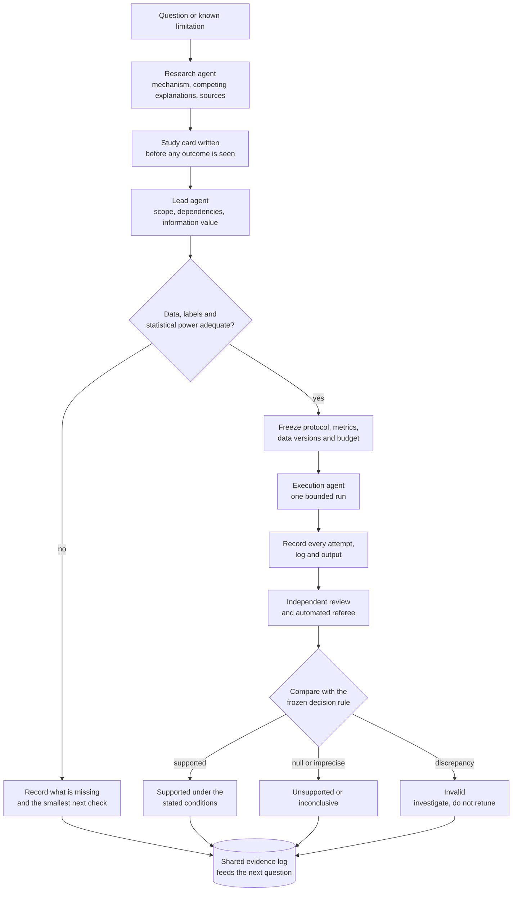

# Research plan

This document describes how new experiments are proposed, tested and reported in Filing Time
Machine, what it would take to close the gaps listed in the [README](../README.md#caveats), three
new study ideas, and candidate data sources. Everything here is a plan: none of these studies has
been run, and no new data source has been adopted.

## How an idea becomes a result

The project is developed with a small team of AI agents that each play one role: a research agent
proposes ideas and checks the literature, a lead agent scopes them, and an execution agent writes
the code and runs approved jobs. The workflow below is designed so that adding agents produces
better-documented answers, not more chances to find a lucky backtest.

Three rules keep the workflow honest:

- **Outcomes come last.** A study card fixes the question, data, measurement, baseline, test and
  budget before anyone looks at results. If any of these is undecided, the study does not run.
- **Nothing is deleted.** Every attempt, including failed and null runs, is appended to the
  [trial ledger](../results/trial_ledger.jsonl) and counts toward the multiple-testing penalty.
- **Three separate verdicts.** Whether a job *ran*, what it *showed scientifically* (supported,
  unsupported, inconclusive or invalid) and whether it is *ready to publish* are tracked separately.
  A completed run can still be invalid evidence.

### What every study card must specify

| Field | Example of what it pins down |
|---|---|
| Question | Mechanism, expected direction, unit of analysis, what the study does *not* claim, and what would falsify it |
| Information set | Data versions, security identifiers, availability clocks and exact time windows |
| Measurement | Feature definition, units, how missing or unknown values are handled, and how labels were validated |
| Comparison | A cheap baseline, the smallest economically meaningful effect, and costs |
| Inference | Unit of dependence, number of independent periods, the test and threshold, and multiple-testing family |
| Execution | Code and environment versions, seed, output schema, and CPU/memory/time limits |
| Prior exposure | Which data has already been looked at, and why the proposed split is still clean |

### Running experiments in isolation

Today the agents share one machine and one repository, with one designated agent writing code and
running jobs.
The planned next step is to run each experiment in a disposable container that has read-only
access to a checksum-pinned data snapshot, no network access, no access to the sealed holdout or
any credentials, and hard CPU/memory/time limits. Before relying on it, the container would be
tested by deliberately trying to read a protected file, reach the network and query data past the
cutoff, and confirming that each attempt fails.

The [offline request/permit checks](DATA_AUDIT.md#offline-cost-run-contract-and-measurement-fixes)
now validate supplied scope, hashes, completed prerequisites, expiry and budgets,
with synthetic failure/null receipts. They do **not** authenticate permissions,
launch workers or enforce host isolation. The planned container remains unprovisioned.

## Closing the known gaps

| Gap | First step | What "done" looks like |
|---|---|---|
| Filing timestamps | An offline screen already shows which filings' trading day, portfolio month or event window would change if their time were off by one Eastern-time offset ([results](../results/p0_assignment_plan.json)); next, check those filings against their own SEC headers | A per-filing table of verified times, with counts of assignments that actually changed and any filings left unresolved |
| Survivorship and identity | Compare data sources on a fixed panel of continuing, merged, delisted and renamed companies | Dated security identities, corporate actions and delisting payoffs that reconcile case by case |
| Real measurement labels | Two people independently label claim changes in 60 real filing pairs, with disagreements adjudicated | Measured precision and recall of claim extraction on real text, not synthetic benchmarks |
| Cheap baselines | Compare simple text-edit, TF-IDF, embedding and rule-based claim matching on the same labelled pairs | Evidence of whether the LLM adds anything beyond simple methods |
| Claim-level signal (H1) | Register the exact comparison, data, effect size and test | One evaluation, reported whatever the outcome |
| More independent periods | Plan a separate older-period study with survivorship-free data | More real, independent months; nominal date ranges alone do not count |
| Model training | Train a small claim matcher only if the labelled audit shows errors it could fix | Splits separated by time and by company, compared against the frozen baselines |
| Trading costs | Record which cost components are observed and which are assumed; compute break-even costs | A realistic net comparison, plus a long-only version that needs no borrowing |

A fine-tuned modern model is not automatically free of look-ahead for old filings, even if its
fine-tuning data is old, because its pretraining may include later text. Measurement models are
trained to read filings correctly, never to predict historical returns.

## Three new study ideas

These are proposals only. Each would need its own study card and must clear the gaps above before
any return is examined.

### Does attention speed up how fast disclosures are priced?

- **Question:** when a company's filing contains meaningful changes, are they priced faster if the
  topics it discusses are already getting heavy news coverage?
- **Mechanism:** investor attention is limited; coverage may reduce the delay before information is
  reflected in prices.
- **Competing explanations:** coverage that follows earlier price moves, sector-wide news, the
  severity of the disclosure itself, and syndicated duplicate stories.
- **Data:** news-volume metadata from [GDELT](https://www.gdeltproject.org/) or official feeds,
  matched to topics already present in earlier filings, plus prices and factors. Publication,
  first-seen and ingestion times are kept separate.
- **Test:** disclosure-only and attention-only baselines against their interaction, measured over
  pre-set early and late return windows.
- **What would falsify it:** coverage that simply tracks past returns, no gain over the baselines,
  or placebo topics working just as well.

### When the story improves but the numbers don't

- **Question:** when management's specific claims become more positive while the accounts already
  known at the time deteriorate, do later fundamentals confirm the story, or is it just disclosure
  style?
- **Mechanism:** delayed recognition or selective framing. Alternatives include genuine turnarounds,
  cyclical businesses, template edits and accounting measurement error. An association would not be
  evidence of misconduct.
- **Data:** report pairs with claims tied to quoted text, and accounting values as first reported,
  with unknown values kept as unknown.
- **Test:** first a measurement-only audit of the divergence indicator; later, separately
  registered, its association with next-year fundamentals against accounting-only and text-only
  baselines.
- **What would falsify it:** the divergence disappears once units and first-reported values are
  corrected, or it is driven by boilerplate.

### Customer shocks travelling to suppliers

- **Question:** when a customer suffers a shock, do suppliers whose relationship was disclosed
  *before* the shock react with a delay, beyond their own news and sector moves? This extends
  hypotheses H2 and H3.
- **Mechanism:** investors may not trace economic links between companies quickly.
- **Data:** customer-supplier links grounded in earlier filings, with dated security identities for
  both companies.
- **Test:** linked suppliers against matched unlinked firms and randomly rewired networks.
- **What would falsify it:** links discovered only later predict just as well, the effect vanishes
  after sector controls, or reversed link direction works equally well.

## Data sources

Survivorship-free historical prices are the single biggest constraint. The project currently uses
free public sources only. Prices below are as listed on the providers' public pages on
2026-11-14; every option's licence must be checked before publishing results derived from it.

### Free and public

| Source | Useful for | Caveat |
|---|---|---|
| [SEC EDGAR](https://www.sec.gov/search-filings/edgar-application-programming-interfaces) | Filings, headers, accounting facts, acceptance times | No historical ticker or delisting-payoff master; JSON acceptance times need header verification |
| [GDELT](https://www.gdeltproject.org/) | News attention and event metadata | Its `DATEADDED` field is when an event entered the database, not when the article was published |
| [Federal Reserve feeds](https://www.federalreserve.gov/feeds/feeds.htm) | Scheduled policy-event times | Rolling feeds do not preserve history or corrections |
| [ALFRED](https://alfred.stlouisfed.org/) | Macro data as it was known on each date | Needs an API key; its API terms restrict caching and use for model training |

### Paid or request-based

| Source | What it offers | Main limitation |
|---|---|---|
| [Norgate Data](https://norgatedata.com/stockmarketpackages.php) US Platinum | Advertises delisted securities, history back to 1990 and historical index membership; about $347 for 6 months or $630 a year | Personal use only, and data must be deleted when the subscription ends; delisting payoffs need checking |
| [EODHD](https://eodhd.com/pricing) | Low-cost API, about $20 a month for historical end-of-day prices | Delisted coverage before 2018 is end-of-day prices only |
| [Sharadar](https://data.nasdaq.com/publishers/SHARADAR) via Nasdaq Data Link | Prices and fundamentals with permanent security identifiers | Personal-use terms restrict publishing evaluations of the data |
| [CRSP](https://indexes.morningstar.com/research-data-products/crsp-us-stock-databases) | The academic standard: active and inactive securities, permanent identifiers, corporate actions | Institutional subscription; individual access is by request |
| [Compustat Point-in-Time](https://www.marketplace.spglobal.com/en/datasets/compustat-financials-%288%29) | Accounting values as originally reported, not later revised | Separate product from ordinary Compustat; by quote |

### Dataset platforms

[Mozilla Data Collective](https://mozilladatacollective.com/datasets),
[Hugging Face](https://huggingface.co/datasets) and [Kaggle](https://www.kaggle.com/datasets) are
useful for finding labelled text for measurement work. Each dataset carries its own licence: for
example, [Financial PhraseBank](https://huggingface.co/datasets/takala/financial_phrasebank) is
CC BY-NC-SA 3.0, which rules out commercial use. No survivorship-free,
point-in-time equity panel on these platforms was qualified by this review;
a generic finance sentiment dataset is not a substitute for labelled pairs
of company disclosures. This is not
proof that a suitable freely licensed source cannot exist.

## Free real measurement evaluations

**Public research completed 2026-11-14; no datasets/models downloaded or
evaluations run.** Research's `CL-FREE-EVAL-20261114-R1` report
(`2f7ee5e7-1b84-4c24-863c-4a4f380c2419`) was read in full. Pins below are
reference revisions, not downloaded-byte checksums or source clearance.

The most practical next real evaluation is a **component measurement benchmark**,
not another return backtest. These provide genuine annotations, but not
representative gold for paired disclosure changes, missing endpoints or H6
follow-up completeness. They are independently constructed datasets, not
necessarily unseen by a model's pretraining.

| Priority / reference pin | Real annotation and unit | Native metrics / important limits |
|---|---|---|
| TAT-QA: [paper](https://aclanthology.org/2021.acl-long.254/) and [author release](https://github.com/NExTplusplus/TAT-QA/tree/870accc41953dcde885aabeb963d94aabdc0fbc3) |16,552questions over2,757table/text contexts from182reports; financially knowledgeable annotators and two verifiers. Dataset explicitly CC BY4.0, distinct from repository MIT. |Official EM/F1, scale/unit/arithmetic and evidence errors. Random context splits are not chronological/report/issuer-disjoint assurance. README says January2024test release, but the [gold-test commit](https://github.com/NExTplusplus/TAT-QA/commit/12fd7c8bb474e8b45e9f54dbf7c281c178f1a510) is dated2024-02-14; preserve both provenance statements. |
| FinQA: [paper v3](https://arxiv.org/html/2109.00122v3) and [author release](https://github.com/czyssrs/FinQA/tree/0f16e2867befa6840783e58be38c9efb9229d742) |8,281expert-authored questions with facts, executable programs and answers; selected1999-2019reports. Public gold test is distinct from the private challenge test. Repository advertises MIT; data/report rights need scoped qualification. |Execution accuracy plus program equivalence and evidence support. Use corrected preprocessing: authors disclose a2022label-leakage bug. Report-disjoint does not prove issuer-disjoint or chronological separation. |
| FinDVer: [paper v1](https://arxiv.org/html/2411.05764v1) and [2026author release](https://github.com/yilunzhao/FinDVer/tree/e8bb237def4ce555a606a45edba22666e31df248) |2,400entailed/refuted financial claims and evidence, based on523early2024filings. Public gold became available inJuly2026; README/history adds MIT. Expert annotation includes GPT-4o refinement and human validation, not purely human-only creation. |Balanced accuracy/macro-F1 and joint label/evidence correctness. No unknown class or temporal claim-change gold. Recent2024documents are not automatically unseen by a2026model; underlying processing/document rights still matter. |
| FinanceBench: [paper](https://arxiv.org/html/2311.11944v1), [official card pin](https://huggingface.co/datasets/PatronusAI/financebench/blob/e04404e3a97f69f79c14d42f24981a1c9c3bcd18/README.md) |Only150public examples, not the full10,231question corpus. Human answers/evidence and some programmatically generated question templates. Card declares CC BY-NC4.0. |Supported answer/numeric correctness and refusal/unsupported-answer rates. Noncommercial restrictions and full-corpus contact gate; open sample not company/year/industry-stratified. Do not mix HF version with later GitHub gold/PDF corrections silently. |
| FinCausal2020: [organizer paper](https://arxiv.org/html/2012.02505v1), [annotation guide](https://arxiv.org/html/2012.02498v1), [organizer repo](https://github.com/yseop/YseopLab/tree/develop/FNP_2020_FinCausal) |Manually labeled2019news sections, causal-language classification and cause/effect spans; organizer declares data CC0. Exact local gold/version and underlying publisher rights not independently qualified here. |Official weighted P/R/F1 and span EM, plus rare positive-class metrics. Group repeated sections/documents. Linguistic cause/effect does not identify economic causation. |
| ConvFinQA: [paper](https://arxiv.org/html/2210.03849v1), [author release](https://github.com/czyssrs/ConvFinQA/tree/cf3eed2d5984960bf06bb8145bcea5e80b0222a6) |3,892conversations/14,115turns derived from FinQA; simulated skeletons realized as annotated questions. MIT repository, but original test evaluation is withheld/CodaLab. |Turn and all-conversation program/execution accuracy; development diagnostic only until local test gold qualified. Not an independent replication of FinQA or automatically account-free test access. |

**Smallest proposed diagnostic:** after explicit release/rights and download/run
approval, start with 30 TAT-QA development questions and, if its release scope is
qualified, 10 FinQA development questions selected by frozen metadata rules.
Review source-report overlap with this project's sealed **fundamental as well
as return** periods before reading any files. A whole-dataset download followed
by selecting 30 items can still expose forbidden material; require a qualified,
isolated measurement snapshot and an exposure inventory first.
Use a deterministic CPU baseline first, separate prediction inputs from gold,
and report every item, coverage/abstention and native metrics. No training,
model acquisition or hosted inference is needed for an initial parser/scorer
diagnostic. Executing the gold program checks the scorer; it does **not**
demonstrate prediction skill.

A separately approved non-overlapping retrospective component benchmark need
not wait for a trading timestamp correction: it can test current financial
reading or arithmetic, with exposure caveats. It cannot validate historical
deployability or replace the P0-blocked project-specific claim-change roster.

The new [exact-ID measurement scorer](../src/asof/measurement.py) provides
completeness/evidence/abstention and split contracts, but it is **not** the
native TAT-QA/FinQA answer/program or FinDVer balanced/macro scorer. A benchmark-specific adapter and
separately frozen baseline are still needed. Forty items can expose defects,
not establish leadership, formal H1, economic predictability or deployment.

## What public Stashbird and CorpGen contribute

Only public papers were used; no private implementations, employer material
or unrestricted code/data/model license was inferred.

- **[Stashbird](https://arxiv.org/html/2609.34242v2)**, *Episode-Grounded Lifecycle
  Reconciliation for Conversational Agent Memory*, revised 2026-10-17:
  retain supporting episodes, multiple support, supersession history and
  invalidation of unsupported searchable state. Transfer that discipline to
  financial claims and historical as-of replay. Its semantic decisions/provenance
  assumptions are not extraction-accuracy proof; reported deletion leaves some
  summaries/checkpoints unchanged, so it is not complete erasure. No original
  freely licensed implementation was qualified.
- **[CorpGen](https://arxiv.org/html/2602.14229v1)**, submitted 2026-02-15:
  task-scoped context, preserved failures/decisions, verified demonstrations
  and evaluation of final artifacts rather than success narratives. Its
  15.2 versus 4.3 figures are task-completion **percentages**, not completed-task
  counts; controlled single-day sessions do not validate an unattended
  multi-agent quant fleet. No original open implementation was qualified.

### Three additional exploratory measurement methods

These are proposed methods, not extra registered return hypotheses:

| Method | Falsifiable comparison | Cheap-first check and stop |
|---|---|---|
| Support-aware bitemporal reconciliation |Append-only retrieval versus source-supported claim versions after repeat/correction/withdrawal; stale-active/unsupported claims and retained valid support |Synthetic mechanics, then independently labeled temporal disclosures. Stop on retroactive signal rewriting or semantic matching that erases valid support. FinDVer alone is not temporal gold. |
| Proof-carrying financial arithmetic |Answer-only versus typed expressions with entity, period, unit, scale and operand evidence; joint numerical/support correctness |Deterministic verifier on qualified TAT-QA/FinQA labels. Reject inconsistent or unsupported operands, but report coverage so abstaining on hard cases cannot create an apparent victory. |
| Evidence-knockout / wrong-period controls |Correct evidence versus indispensable-evidence removal, unrelated replacement and same-entity/wrong-period material |First verify the control truly lacks alternate valid evidence. Unchanged answers can suggest a grounding problem, not prove memorization or causality by themselves. |

No acceptance margin or dataset/model-resource approval comes from this
research. Pretraining/benchmark exposure, preprocessing versions and source
overlap must accompany any result. Current P0 and return holds remain.

### What remains missing for free return evaluation

No free complete terminal-payoff source was certified in the bounded review;
this is not proof none exists. [Nasdaq directory docs](https://www.nasdaqtrader.com/Trader.aspx?id=SymbolDirDefs)
describe current status/files, not a historical permanent-security/payoff master.
[Alpaca docs](https://docs.alpaca.markets/us/docs/about-market-data-api) describe
market-history/feed access but require authentication and do not establish
complete inactive/cash/stock/CVR payoff coverage. A public
[verifiable-data architecture](https://github.com/Szigor-Research/verifiable-equity-data)
explicitly lacks earlier survivorship-free membership and complete terminal
actions; its code license does not grant vendor data rights.

Free component benchmarks can unblock real **measurement evaluation** once
qualified. They cannot clear timestamp authority, historical security/payoffs,
real project gold, economic costs, sample-size qualification or sealed-holdout
permission.

## Testing the workflow itself

Whether a team of agents does better research than a single agent is itself a testable question.
A fair comparison would give both the same tools, data and total compute; run them on
method and measurement tasks that involve no market outcomes; and score them blind on time to a
well-specified study, defects caught before evaluation, reproducibility, and how faithfully null
results are reported. The number of statistically significant strategies found would be a bad
metric, because it rewards searching until something works.
