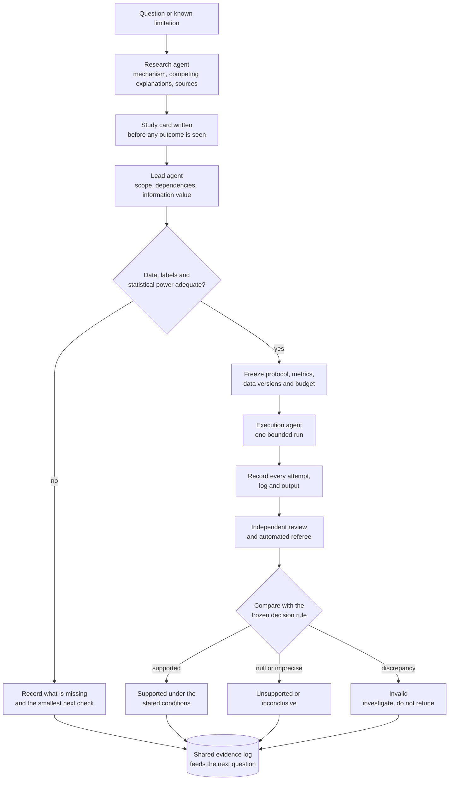

# Research plan

This document describes how new experiments are proposed, tested and reported in Filing Time
Machine, what it would take to close the gaps listed in the [README](../README.md#caveats), three
new study ideas, and candidate data sources. Everything here is a plan: none of these studies has
been run, and no new data source has been adopted.

## How an idea becomes a result

The project is developed with a small team of AI agents that each play one role: a research agent
proposes ideas and checks the literature, a lead agent scopes them, and an execution agent writes
the code and runs approved jobs. The workflow below is designed so that adding agents produces
better-documented answers, not more chances to find a lucky backtest.



Three rules keep the workflow honest:

- **Outcomes come last.** A study card fixes the question, data, measurement, baseline, test and
  budget before anyone looks at results. If any of these is undecided, the study does not run.
- **Nothing is deleted.** Every attempt, including failed and null runs, is appended to the
  [trial ledger](../results/trial_ledger.jsonl) and counts toward the multiple-testing penalty.
- **Three separate verdicts.** Whether a job *ran*, what it *showed scientifically* (supported,
  unsupported, inconclusive or invalid) and whether it is *ready to publish* are tracked separately.
  A completed run can still be invalid evidence.

### What every study card must specify

| Field | Example of what it pins down |
|---|---|
| Question | Mechanism, expected direction, unit of analysis, what the study does *not* claim, and what would falsify it |
| Information set | Data versions, security identifiers, availability clocks and exact time windows |
| Measurement | Feature definition, units, how missing or unknown values are handled, and how labels were validated |
| Comparison | A cheap baseline, the smallest economically meaningful effect, and costs |
| Inference | Unit of dependence, number of independent periods, the test and threshold, and multiple-testing family |
| Execution | Code and environment versions, seed, output schema, and CPU/memory/time limits |
| Prior exposure | Which data has already been looked at, and why the proposed split is still clean |

### Running experiments in isolation

Today the agents share one machine and one repository, with one designated agent writing code and
running jobs.
The planned next step is to run each experiment in a disposable container that has read-only
access to a checksum-pinned data snapshot, no network access, no access to the sealed holdout or
any credentials, and hard CPU/memory/time limits. Before relying on it, the container would be
tested by deliberately trying to read a protected file, reach the network and query data past the
cutoff, and confirming that each attempt fails.

The [offline request/permit checks](DATA_AUDIT.md#offline-cost-run-contract-and-measurement-fixes)
now validate supplied scope, hashes, completed prerequisites, expiry and budgets,
with synthetic failure/null receipts. They do **not** authenticate permissions,
launch workers or enforce host isolation. The planned container remains unprovisioned.

## Closing the known gaps

| Gap | First step | What "done" looks like |
|---|---|---|
| Filing timestamps | An offline screen already shows which filings' trading day, portfolio month or event window would change if their time were off by one Eastern-time offset ([results](../results/p0_assignment_plan.json)); next, check those filings against their own SEC headers | A per-filing table of verified times, with counts of assignments that actually changed and any filings left unresolved |
| Survivorship and identity | Compare data sources on a fixed panel of continuing, merged, delisted and renamed companies | Dated security identities, corporate actions and delisting payoffs that reconcile case by case |
| Real measurement labels | Two people independently label claim changes in 60 real filing pairs, with disagreements adjudicated | Measured precision and recall of claim extraction on real text, not synthetic benchmarks |
| Cheap baselines | Compare simple text-edit, TF-IDF, embedding and rule-based claim matching on the same labelled pairs | Evidence of whether the LLM adds anything beyond simple methods |
| Claim-level signal (H1) | Register the exact comparison, data, effect size and test | One evaluation, reported whatever the outcome |
| More independent periods | Plan a separate older-period study with survivorship-free data | More real, independent months; nominal date ranges alone do not count |
| Model training | Train a small claim matcher only if the labelled audit shows errors it could fix | Splits separated by time and by company, compared against the frozen baselines |
| Trading costs | Record which cost components are observed and which are assumed; compute break-even costs | A realistic net comparison, plus a long-only version that needs no borrowing |

A fine-tuned modern model is not automatically free of look-ahead for old filings, even if its
fine-tuning data is old, because its pretraining may include later text. Measurement models are
trained to read filings correctly, never to predict historical returns.

## Three new study ideas

These are proposals only. Each would need its own study card and must clear the gaps above before
any return is examined.

### Does attention speed up how fast disclosures are priced?

- **Question:** when a company's filing contains meaningful changes, are they priced faster if the
  topics it discusses are already getting heavy news coverage?
- **Mechanism:** investor attention is limited; coverage may reduce the delay before information is
  reflected in prices.
- **Competing explanations:** coverage that follows earlier price moves, sector-wide news, the
  severity of the disclosure itself, and syndicated duplicate stories.
- **Data:** news-volume metadata from [GDELT](https://www.gdeltproject.org/) or official feeds,
  matched to topics already present in earlier filings, plus prices and factors. Publication,
  first-seen and ingestion times are kept separate.
- **Test:** disclosure-only and attention-only baselines against their interaction, measured over
  pre-set early and late return windows.
- **What would falsify it:** coverage that simply tracks past returns, no gain over the baselines,
  or placebo topics working just as well.

### When the story improves but the numbers don't

- **Question:** when management's specific claims become more positive while the accounts already
  known at the time deteriorate, do later fundamentals confirm the story, or is it just disclosure
  style?
- **Mechanism:** delayed recognition or selective framing. Alternatives include genuine turnarounds,
  cyclical businesses, template edits and accounting measurement error. An association would not be
  evidence of misconduct.
- **Data:** report pairs with claims tied to quoted text, and accounting values as first reported,
  with unknown values kept as unknown.
- **Test:** first a measurement-only audit of the divergence indicator; later, separately
  registered, its association with next-year fundamentals against accounting-only and text-only
  baselines.
- **What would falsify it:** the divergence disappears once units and first-reported values are
  corrected, or it is driven by boilerplate.

### Customer shocks travelling to suppliers

- **Question:** when a customer suffers a shock, do suppliers whose relationship was disclosed
  *before* the shock react with a delay, beyond their own news and sector moves? This extends
  hypotheses H2 and H3.
- **Mechanism:** investors may not trace economic links between companies quickly.
- **Data:** customer-supplier links grounded in earlier filings, with dated security identities for
  both companies.
- **Test:** linked suppliers against matched unlinked firms and randomly rewired networks.
- **What would falsify it:** links discovered only later predict just as well, the effect vanishes
  after sector controls, or reversed link direction works equally well.

## Data sources

Survivorship-free historical prices are the single biggest constraint. The project currently uses
free public sources only. Prices below are as listed on the providers' public pages on
2026-11-14; every option's licence must be checked before publishing results derived from it.

### Free and public

| Source | Useful for | Caveat |
|---|---|---|
| [SEC EDGAR](https://www.sec.gov/search-filings/edgar-application-programming-interfaces) | Filings, headers, accounting facts, acceptance times | No historical ticker or delisting-payoff master; JSON acceptance times need header verification |
| [GDELT](https://www.gdeltproject.org/) | News attention and event metadata | Its `DATEADDED` field is when an event entered the database, not when the article was published |
| [Federal Reserve feeds](https://www.federalreserve.gov/feeds/feeds.htm) | Scheduled policy-event times | Rolling feeds do not preserve history or corrections |
| [ALFRED](https://alfred.stlouisfed.org/) | Macro data as it was known on each date | Needs an API key; its API terms restrict caching and use for model training |

### Paid or request-based

| Source | What it offers | Main limitation |
|---|---|---|
| [Norgate Data](https://norgatedata.com/stockmarketpackages.php) US Platinum | Advertises delisted securities, history back to 1990 and historical index membership; about $347 for 6 months or $630 a year | Personal use only, and data must be deleted when the subscription ends; delisting payoffs need checking |
| [EODHD](https://eodhd.com/pricing) | Low-cost API, about $20 a month for historical end-of-day prices | Delisted coverage before 2018 is end-of-day prices only |
| [Sharadar](https://data.nasdaq.com/publishers/SHARADAR) via Nasdaq Data Link | Prices and fundamentals with permanent security identifiers | Personal-use terms restrict publishing evaluations of the data |
| [CRSP](https://indexes.morningstar.com/research-data-products/crsp-us-stock-databases) | The academic standard: active and inactive securities, permanent identifiers, corporate actions | Institutional subscription; individual access is by request |
| [Compustat Point-in-Time](https://www.marketplace.spglobal.com/en/datasets/compustat-financials-%288%29) | Accounting values as originally reported, not later revised | Separate product from ordinary Compustat; by quote |

### Dataset platforms

[Mozilla Data Collective](https://mozilladatacollective.com/datasets),
[Hugging Face](https://huggingface.co/datasets) and [Kaggle](https://www.kaggle.com/datasets) are
useful for finding labelled text for measurement work. Each dataset carries its own licence: for
example, [Financial PhraseBank](https://huggingface.co/datasets/takala/financial_phrasebank) is
CC BY-NC-SA 3.0, which rules out commercial use. None of the platforms offered a survivorship-free,
point-in-time equity panel, and a generic finance sentiment dataset is not a substitute for labelled
pairs of company disclosures.

## Free benchmarks for testing measurement on real data

The project's extraction benchmark uses synthetic labels. Before testing new return signals, the
cheapest real check is whether the measurement tools read financial documents correctly. Several
free, human-annotated benchmarks can test that. A small deterministic baseline
has now been tested on 30 TAT-QA development questions. It matched five reference
answers, gave four wrong answers and declined the other 21. No language model
or training was used.

| Benchmark | What it labels | How it is scored | Watch out for |
|---|---|---|---|
| [TAT-QA](https://github.com/NExTplusplus/TAT-QA) ([paper](https://aclanthology.org/2021.acl-long.254/)) | 16,552 questions over tables and text from 182 annual reports, written by financially trained annotators and checked by two verifiers | Exact match and F1, including scale, units and arithmetic | Splits are random, not by company or date; data is CC BY 4.0 |
| [FinQA](https://github.com/czyssrs/FinQA) ([paper](https://arxiv.org/abs/2109.00122)) | 8,281 expert-written questions with the facts and the calculation that answers each one, from 1999-2019 reports | Execution accuracy of the calculation | Use the corrected preprocessing: the authors disclosed and corrected a label-leak bug in 2022 |
| [FinDVer](https://github.com/yilunzhao/FinDVer) ([paper](https://arxiv.org/abs/2411.05764)) | 2,400 true-or-false financial claims with supporting evidence, from early-2024 filings | Balanced accuracy and macro-F1, plus whether the cited evidence is right | Recent documents may already be in a modern model's training data |
| [FinanceBench](https://huggingface.co/datasets/PatronusAI/financebench) ([paper](https://arxiv.org/abs/2311.11944)) | 150 public question-answer pairs with evidence (the full set is gated) | Answer correctness and refusal rate | Non-commercial licence (CC BY-NC 4.0) and a small sample |
| [FinCausal 2020](https://github.com/yseop/YseopLab/tree/develop/FNP_2020_FinCausal) ([paper](https://arxiv.org/abs/2012.02505)) | Cause-and-effect spans in 2019 financial news | Weighted precision, recall and F1 | Linguistic cause and effect is not economic causation |
| [ConvFinQA](https://github.com/czyssrs/ConvFinQA) ([paper](https://arxiv.org/abs/2210.03849)) | 3,892 multi-turn conversations built on FinQA | Turn-level and conversation-level accuracy | Derived from FinQA, so not an independent check; its test answers are held back |

### The first real-data diagnostic

Before opening files, we checked their source history against the sealed test
period, including the fundamental study rather than just stock prices. The
TAT-QA development file has been unchanged since May 2021. FinQA was initially
paused because its file changed in 2022; a check of report IDs alone found all
883 IDs named report years 2001-2019, with none unparseable. Its other fields were not
read before that check.

We then froze a seed and randomly selected 30 TAT-QA development questions,
without filtering by question type or answer. The baseline looks for a unique
table-row label and an explicit year, then applies a few fixed arithmetic and
unit rules. It receives no reference answers, calculation steps or answer-type
labels. Unsupported or ambiguous questions produce an abstention.

| Result on the 30 items | Value |
|---|---:|
| Reference answer matched | 5 |
| Wrong answer | 4 |
| Abstained | 21 |
| Official exact match | 16.7% |
| Exact-match 95% Wilson interval | 7.3-33.6% |
| Official F1 | 16.7% |
| Official scale accuracy | 26.7% |

The unmodified TAT-QA scorer includes the abstentions in these scores.
The baseline answered only nine questions; quoting five correct out of those
nine alone would hide its low coverage. Scores cover the selected 30 IDs;
running the upstream command on the entire development file would use a
different denominator. The run took about 1.58 CPU seconds
and used about 119 MiB of memory. Data, official scorer code and predictions
stay local; [configuration](../results/benchmark_diagnostic_config.json) and
[results](../results/benchmark_diagnostic_status.json) record versions,
checksums and every item's outcome without copying the questions or answers.

### FinQA follow-up with the original rules

FinQA was not scored in the first diagnostic because its official evaluator
lacked `tqdm`. The follow-up installed only the pinned benchmark dependencies:
`tqdm 4.70.1`, `sympy 1.14.0` and `mpmath 1.3.0`, reproduced by the `benchmarks`
extra. No scorer was substituted.

Before changing the average rule, we froze ten unfiltered development IDs with
a new seed, the unchanged original baseline, and deterministic adapters for raw
text/table inputs and FinQA calculation programs. Reference answers and retrieved
annotations were not prediction inputs; percentages were represented as ratios.

The original rules declined **all ten items**. With abstentions counted as
misses, execution accuracy was **0/10**, with a descriptive 95% Wilson interval
of **0-27.8%**, and coverage was zero. No dataset prediction program or gold
program was executed, because the baseline emitted no answers. Two invented
arithmetic programs passed a separate native-executor check; that is a scorer
check, not question-answering performance. The file remains local after its
report-ID check. [Follow-up results](../results/benchmark_followup_status.json)
record each outcome and the frozen configuration.

### Average-only correction and a fresh paired comparison

Only after the FinQA result was committed did we inspect the three earlier
average errors. They exposed three different issues:

- An explicit year range was averaged using its endpoints, omitting an
  intermediate year.
- A signed expense had an ambiguous positive-magnitude convention, and its
  table's unit banner appeared later than the global unit scan.
- A metric with "weighted-average" in its name was requested separately by year;
  that was not an instruction to average the values.

The change is confined to the average rule. It includes every observed year in
an explicit range, considers a table-local unit banner, and declines ambiguous
expense signs or ordered/weighted-metric lookups rather than guessing. Other
row, year, ratio, unit and output-type rules were left alone. In particular,
the limitations behind FinQA's abstentions were not broadened away.

We froze a new seed and **30 fresh TAT-QA development items**, excluding every
item in the original sample, then ran the original and corrected versions once
on the same items. The original 30 were not re-scored or overwritten.

| Result on the fresh 30 | Original rules | Average-only correction |
|---|---:|---:|
| Reference matches / wrong / abstained | 3 / 0 / 27 | 3 / 0 / 27 |
| Official exact match | 10.0% | 10.0% |
| Exact-match 95% Wilson interval | 3.5-25.6% | 3.5-25.6% |
| Official F1 | 10.0% | 10.0% |
| Official scale accuracy | 10.0% | 10.0% |
| Coverage | 10.0% | 10.0% |

No prediction changed: zero items improved and zero regressed. **None of these
fresh items reached the average calculation**, so the sample does not
demonstrate a real-data benefit from the correction. Synthetic tests check the
mechanics; we did not choose another sample until a gain appeared.

These intervals describe question-level binomial accuracy; they do not adjust
for shared reports or contexts. F1 is not given a binomial interval, and
overlapping intervals are not a paired significance test. Here scale and
coverage also have 3/30 support, so their Wilson intervals are the same.

For context, [the TAT-QA paper, Table 3 and section 4.3](https://arxiv.org/html/2105.07624v2#S4.T3)
reports human experts at **84.1% exact match** and 90.8% F1 on 301 test questions
from 50 contexts. That different test sample and its conditions are not a matched
comparison with these tiny development samples.

These are checks of a very limited baseline, not evidence of broad
financial-reading skill. Thirty to forty items can expose bugs; they cannot
establish formal H1, benchmark leadership or historical usability. A benchmark's
own reference calculations would test the scorer, not prediction skill. This
diagnostic did not inspect prices, returns or the sealed test period.

### Existing local reader: incomplete first check

The already-installed Qwen 3.5 4B was tested on ten fresh development questions,
excluding the earlier sixty question IDs. Each question had a report-supplied
condition and a no-report control; unchanged symbolic rules used the same ten.
The [prospective contract](../results/reader_diagnostic_config_v2.json) pins the
model digest, server version, options, selection and native scorer. Its technical
revision before inference kept the first contract's items and model unchanged.

| Condition, ten selected questions each | Correct | Wrong | Abstained | Failed | Not attempted |
|---|---:|---:|---:|---:|---:|
| Local reader with report | 0 | 0 | 4 | 1 | 5 |
| Local reader without report | 0 | 0 | 4 | 0 | 6 |
| Unchanged symbolic rules | 1 | 1 | 8 | 0 | 0 |

Eight model requests completed, all with abstentions. The ninth request, with a
report, exceeded its 90-second limit; the run stopped without retrying and left
eleven condition/question cases unattempted. Thus model exact match, F1, scale
accuracy and coverage are zero on the fixed ten-question denominator, counting
failures and unattempted cases as misses. **That is an incomplete pipeline result,
not an estimate that the model has zero reading skill.** The rules scored 10%
EM/F1/scale and 20% coverage; its descriptive EM Wilson interval is 1.8-40.4%.
The model's all-selected binary interval is 0-27.8%, not a competence interval.

The [original result](../results/reader_diagnostic_status.json) is preserved.
The [post-run review](../results/reader_diagnostic_review.json) explains an
incorrect generic resource label on skipped cases: they followed the transport
timeout, not a memory or total-wall-time ceiling. The current runner propagates
that cause correctly; no predictions or native scores were rerun.

The single-CPU-thread run took 6.1 minutes. Completed requests averaged 53.4
seconds with the report and 15.5 seconds without it; the largest isolated model
process peaked near 4.7 GiB. Its separate server was stopped afterwards. These
are operational observations, not matched-quality model comparisons.

The ten questions came from nine contexts, two also used by earlier questions.
The current model may have seen this public benchmark during training.
No-report abstention cannot prove otherwise. Location/quote checks are not
proof of answer support, and no non-abstained model answer exercised them here.
That failure motivated the invented positive control below; human-reviewed
support checks are still needed. Neither model
acquisition, training, formal H1, historical usability nor a return test follows.
The run used no prices, returns or sealed test data.

Software checks need no model service:

```powershell
python -m pytest -q tests\test_reader_diagnostic.py tests\test_cached_timestamps.py tests\test_timeutil.py
```

The saved inference used source revision `9c14fec`; reproducing model requests
requires that revision, the pinned existing model/server and a separate run
decision. Changing the timeout or rerunning the exposed questions was not done.

### Invented positive control: can the reader answer at all?

An [offline check of the eight saved responses](../results/reader_pc1_diagnosis.json)
found explicit, valid abstentions: normal endings, only 23-24 generated tokens,
no visible thinking or empty output, and no token-limit hit. They were not
parse failures converted into abstentions.

The [next control was specified before running](../results/reader_pc1_config.json):
twelve invented reports, with four cell lookups, four arithmetic questions,
two text lookups and two missing-answer controls. The answer-first instruction
and output-field ordering passed the fixed rule: **9/10 answerable items correct,
including units, and 2/2 correct abstentions**. One answer had the right count
but incorrectly labelled it percent. It remains wrong; nothing was tuned or rerun.

The old instruction/schema, tested with the same four-thread runtime, scored
1/10 plus both abstentions. Five outputs were singleton lists rejected by the
declared scalar-only scoring rule, so the score difference also reflects format,
not just factual accuracy. Prompt wording and field ordering changed together; the test
cannot identify which caused the difference.

All 24 requests completed in 2.75 minutes. Actual launch CPU averaged 68.3%;
brief peaks reached 98.5%, but the fixed three-consecutive-second stop did not
fire. The largest isolated model process peaked near 4.2 GiB and was stopped
afterward. The [per-item result](../results/reader_pc1_status.json) preserves
every outcome. **This establishes trivial harness function, not reading skill.**

A [proposal for thirty fresh real questions](../results/reader_next_real_proposal.json)
excluded all seventy earlier question IDs. It was later run under the amended
limits below; the original proposal remains as its planning record.

### Fresh real reader sample: partial results

The [earlier thirty-question run](../results/reader_real1_status.json) was
stopped by an over-sensitive safeguard, with no reading result. Its records
remain unchanged; the new run is a fresh sample, not a resume.

The [new contract](../results/reader_real2_config.json) drew thirty questions
with seed 2026111415, excluding all hundred earlier IDs. It kept the exact
positive-control prompt/schema/parse, model and native scorer, but replaced
spike-sensitive CPU stopping with a sustained rolling-average rule and checked
input/output token fit instead of a tight byte cap.

| Native result, all thirty selected questions | Report supplied | No report |
|---|---:|---:|
| Exact match / F1 | 20.0% / 20.0% | 0% / 0% |
| Exact-match Wilson 95% interval | 9.5-37.3% | 0-11.4% |
| Scale accuracy | 30.0% | 0% |
| Coverage | 33.3% | 0% |
| Correct / wrong / abstained / failed / not attempted | 6 / 4 / 0 / 1 / 19 | 0 / 0 / 10 / 0 / 20 |

**The run is incomplete.** Ten pairs finished: the reader answered six of these
questions exactly with their report; every no-report response abstained. One
further report-supplied request was cancelled when sampled owned working set
crossed 6 GiB. The table's all-thirty denominator counts failures and unattempted
cases as misses; it is not the completed-sample model accuracy.

The all-selected paired counts are six right only with the report, zero only
without, zero both-right and twenty-four neither-right. On the ten valid pairs,
the neither-right count is four. Exact McNemar p = 0.03125 is **descriptive only**;
resource-related missingness, repeated report contexts and the public benchmark
limit interpretation. No-report correctness may reflect memorization or guessing,
and these abstentions do not establish a clean training cutoff.

The [per-item result and full CPU trace](../results/reader_real2_status.json) retain
all outcomes and answer-type counts: 10 span, 4 multi-span, 15 arithmetic and
1 count. Completed pairs included 3 span, 2 multi-span and 5 arithmetic cases.
The [review](../results/reader_real2_review.json) records the 5.7-minute run,
zero timeouts or detected truncations, and successful token-bound checks.
Instantaneous CPU spikes reached 100%, but the highest sixty-second mean was
87.35%, so the revised CPU rule did not stop the run. The memory safeguard did;
the isolated server was stopped afterwards. No retry, tuning or resampling.

This demonstrates limited reading ability on the completed public-benchmark
subset, not a finished thirty-question evaluation, historical usability,
formal H1, or financial returns. Question-level intervals do not correct for
shared contexts or resource-driven missingness; no binomial interval is used for F1.

### Three measurement ideas worth testing

| Idea | What it compares | Cheapest first check |
|---|---|---|
| Claims that keep their history | Plain retrieval against claims that track which filings support them and drop out when a later filing withdraws or corrects them | Synthetic sequences of repeated, corrected and withdrawn claims, then real labelled disclosures |
| Arithmetic that shows its work | A bare numeric answer against one that names each operand's company, period, unit and source | A deterministic checker on TAT-QA and FinQA labels, reporting how often it abstains |
| Taking the evidence away | Answers with the correct evidence against answers with that evidence removed, replaced, or swapped for the wrong year | First confirm the control truly lacks another valid source; an unchanged answer suggests the model isn't grounded, but doesn't prove it memorised |

### Still missing for return tests

No free source found so far provides a complete, survivorship-free history of US stocks with
delisting payoffs. Current exchange symbol directories describe today's listings only, and free
brokerage market-data APIs need an account and don't document full delisting and merger payoffs.
Free measurement benchmarks can improve how filings are read, but they can't fix the return sample,
the timestamp checks, trading costs or the sample-size limits described in the README.

## Testing the workflow itself

Whether a team of agents does better research than a single agent is itself a testable question.
A fair comparison would give both the same tools, data and total compute; run them on
method and measurement tasks that involve no market outcomes; and score them blind on time to a
well-specified study, defects caught before evaluation, reproducibility, and how faithfully null
results are reported. The number of statistically significant strategies found would be a bad
metric, because it rewards searching until something works.
