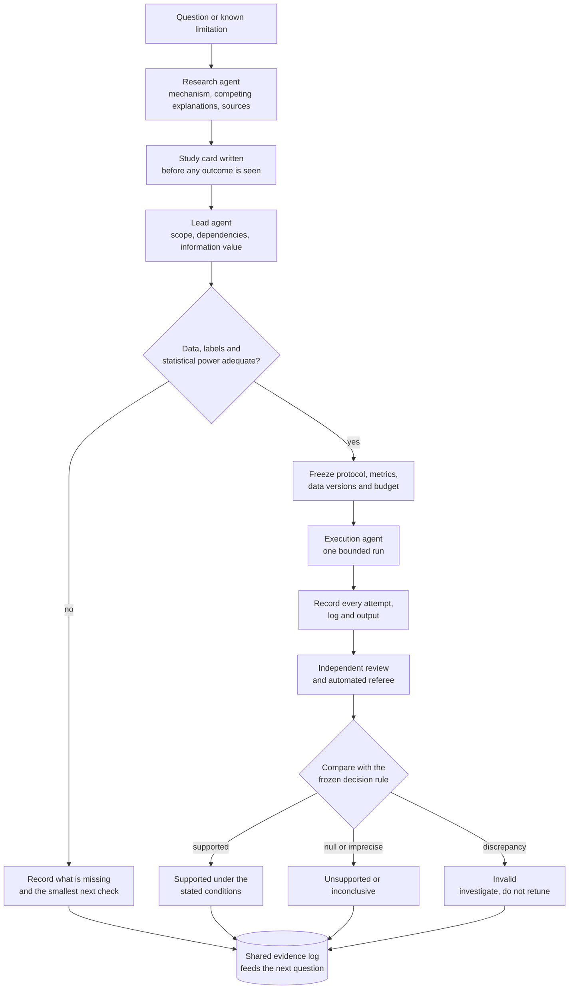

# Research plan

This document describes how new experiments are proposed, tested and reported in Filing Time
Machine, what it would take to close the gaps listed in the [README](../README.md#caveats), three
new study ideas, and candidate data sources. The new studies and source proposals remain plans;
completed measurement checks and audits are labelled below. No new data source has been adopted.

## Literature-backed upgrade priorities

The [2026-11-17 research review](RESEARCH_REVIEW_2026_11.md) connects recent financial NLP and
econometrics to the recorded failures: evidence-localization and real paired-claim measurement,
validation-sample correction of model errors, prospectively frozen finite-population audits
with unread-case accounting, and economically meaningful inference/power design. It separates
retrospective measurement from historically implementable prediction and includes primary
sources, assumptions, rejected shortcuts and proposed work packages. These are recommendations,
not new registrations, source clearance, execution permission or replacements for stopped results.

The [quant research frontiers review](QUANT_RESEARCH_FRONTIERS_2026_11.md) extends
this agenda into information economics, strategic disclosure, order-aware rough-path
features, typed economic transmission, the complexity debate, robust dynamic control
and partial identification. It develops a mechanism-first research thesis and ranked
proposals from 24 sources, not another implemented strategy or an execution approval.

Under a subsequent `all_offline` approval, the [offline quant toolkit](OFFLINE_QUANT_TOOLKIT.md)
implements working reference algorithms for all nine frontier directions. Its
invented-fixture checks test mathematics and access-free composition, not the
economic claims, calibration or predictive performance of any proposed study.

The first implementation is the [offline audit confidence sequence](AUDIT_CONFIDENCE_SEQUENCE.md),
with conservative unread-sampled-label unions. Its [frozen invented-data check](../results/audit_cs_validation.json)
completed all 30,000 paths within the approved resource limits and passed the declared
implementation-QA screen; the full software suite passed 510 tests.
It does not import A2 counts, resume collection or establish the historical sampling
and field-clock assumptions. Measurement-error estimators and reader changes remain proposals.

A separate [cached KPI-omission workflow](KPI_OMISSION_STUDY.md) was implemented, but its first
screen stopped and its 2021-2024 disclosure roster is **quarantined pending cross-hypothesis
reserved-window review**. Being before the July 2024 return holdout does not clear H4/H6(a)
reservations or their outcome-source windows. No KPI finding, human-gold accuracy or economic
result is released. Parser repairs and conservative access guards were checked on invented
fixtures only; no source screen was resumed.

Under [D13](DEVIATIONS.md#d13-exploratory-kpi-disclosure-screen-crossed-reserved-calendars),
a **separate development-only replacement** screened 50 of a new 64-case roster before its
frozen cooperative wall stop. All pinned dates passed the [shared guard](DOCUMENT_SCOPE.md).
The [execution/interpretation](KPI_DEVELOPMENT_STUDY.md) preserves one lexical backlog flag,
but AI-assisted review found insufficient evidence of an issuer-specific KPI omission.
There is no gold, novelty or alpha claim, no automatic continuation and no detector retuning.
The old roster remains quarantined; D13/D6's H4/H6(a) holdout limitation is not cleared.

## How an idea becomes a result

The project is developed with a small team of AI agents that each play one role: a research agent
proposes ideas and checks the literature, a lead agent scopes them, and an execution agent writes
the code and runs approved jobs. The workflow below is designed so that adding agents produces
better-documented answers, not more chances to find a lucky backtest.



Three rules keep the workflow honest:

- **Outcomes come last.** A study card fixes the question, data, measurement, baseline, test and
  budget before anyone looks at results. If any of these is undecided, the study does not run.
- **Nothing is deleted.** Return-hypothesis trials, including failed and null runs, are appended
  to the [trial ledger](../results/trial_ledger.jsonl) and count toward their multiple-testing
  family. Component measurements and audits keep separate receipts; they do not silently change
  the return-trial denominator.
- **Three separate verdicts.** Whether a job *ran*, what it *showed scientifically* (supported,
  unsupported, inconclusive or invalid) and whether it is *ready to publish* are tracked separately.
  A completed run can still be invalid evidence.

### What every study card must specify

| Field | Example of what it pins down |
|---|---|
| Question | Mechanism, expected direction, unit of analysis, what the study does *not* claim, and what would falsify it |
| Information set | Data versions, security identifiers, availability clocks and exact time windows |
| Measurement | Feature definition, units, how missing or unknown values are handled, and how labels were validated |
| Comparison | A cheap baseline, the smallest economically meaningful effect, and costs |
| Inference | Unit of dependence, number of independent periods, the test and threshold, and multiple-testing family |
| Execution | Code and environment versions, seed, output schema, and CPU/memory/time limits |
| Prior exposure | Which data has already been looked at, and why the proposed split is still clean |

### Running experiments in isolation

Today the agents share one machine and one repository, with one designated agent writing code and
running jobs.
The planned next step is to run each experiment in a disposable container that has read-only
access to a checksum-pinned data snapshot, no network access, no access to the sealed holdout or
any credentials, and hard CPU/memory/time limits. Before relying on it, the container would be
tested by deliberately trying to read a protected file, reach the network and query data past the
cutoff, and confirming that each attempt fails.

The [offline request/permit checks](DATA_AUDIT.md#offline-cost-run-contract-and-measurement-fixes)
now validate supplied scope, hashes, completed prerequisites, expiry and budgets,
with synthetic failure/null receipts. They do **not** authenticate permissions,
launch workers or enforce host isolation. The planned container remains unprovisioned.

## Closing the known gaps

The [2026-11-17 closure review](../results/project_closure_review.json) records what software
can close and what still needs data, people or a new scientific design. The referee now refuses
empty success and explicitly checks the recorded clock/calibration failures. A bounded live
runtime smoke confirms the retained prompt cache is disabled, but does not validate reading
accuracy or long-report memory safety. None of these fixes creates a trading result.

| Gap | First step | What "done" looks like |
|---|---|---|
| Filing timestamps | [A4](../results/timestamp_full_a4_report_r2.json) qualified all 16,921 timing-sensitive accessions and resolved all 404 identity disagreements; five MHLA filings are stored 4-5 hours early | Replace those stored times under a logged deviation and rerun the affected development results; qualify the one possible early-close date |
| Survivorship and identity | Compare data sources on a fixed panel of continuing, merged, delisted and renamed companies | Dated security identities, corporate actions and delisting payoffs that reconcile case by case |
| Real measurement labels | Recruit two annotators and an adjudicator, qualify/freeze the roster and use the [draft guide](H1_DESIGN.md#annotation-guide-h1-claim-guide-draft-01) and [empty first-pass template](h1_annotation_first_pass_template.csv); no labels exist | Measured precision and recall on real text, with coverage, agreement and company-separated audit results |
| Cheap baselines | Compare simple text-edit, TF-IDF, embedding and rule-based claim matching on the same labelled pairs | Evidence of whether the LLM adds anything beyond simple methods |
| Claim-level signal (H1) | Start with the [draft measurement-first design](H1_DESIGN.md); resolve inference and power before registering a return test | One valid comparison, reported whatever the outcome, separating registered claim alpha from incremental value beyond word change |
| More independent periods | Plan a separate older-period study with survivorship-free data | More real, independent months; nominal date ranges alone do not count |
| Model training | Train a small claim matcher only if the labelled audit shows errors it could fix | Splits separated by time and by company, compared against the frozen baselines |
| Trading costs | Record which cost components are observed and which are assumed; compute break-even costs | A realistic net comparison, plus a long-only version that needs no borrowing |
| Local-model runtime | Three invented calls verified the pinned cache-zero setting and per-PID telemetry; keep the existing memory stop | Separately approved long-context stress evidence if needed; a short smoke is not a memory-cure or measurement claim |

The [approved timestamp inventory](../results/timestamp_full_plan.json) covers 16,921 distinct
assignment-risk accessions, including all 108 designated clock disagreements. It inventories
34,354 distinct header/index URLs across both original CIK paths where needed, with 102 pinned
cache hits. The user approved at most 34,262 new requests and a project ceiling of 34,402.
The [original run](../results/timestamp_full_review.json) stopped on HTTP 503 at total usage
1,421. Its coarse-clock spacing was a precision miss against our own protocol, not a SEC
fair-access breach. A separately approved [A1 amendment](../results/timestamp_full_a1_config.json)
kept the population and parsing unchanged, used high-resolution pacing, and checked all
108 clock disagreements before a seeded random remainder. The API matches all 108 under the
Eastern assumption; bulk is five hours later in 37 cases and four hours later in 71.
[A2](../results/timestamp_full_a2_review.json) then froze the next 3,000 new random-rest accessions,
but stopped on a second HTTP 503 after only 50, with 109 attempts and nine waits/retries.
A2 ended at total usage 3,246 of 34,402; all 108 A2 QPC gaps met 0.667 seconds.
Across the A1+A2 random-rest sample, one of 314 readable internally agreeing cases differs from
the header under Eastern, giving a nominal one-sided 95% Clopper-Pearson upper bound of 1.50%.
The fixed selection has 2,955 unread/unvisited eligible cases; treating all as errors raises
that upper bound to 91.26%, so the complete-case result cannot certify the remaining cohort.
The statistic was defined after A1 was seen but before A2, and ordinary CP is not a sequential
confidence guarantee under error-dependent stopping. Cumulative conditional comparisons cover
1,311 accessions: no API-side assignment changes, but 30 first-close and one latest-filing choice
change versus bulk on the original nominal calendar. These are not verified UTC corrections.
The separate official-document review used eight more GETs (current usage 3,254 of 34,402),
without continuing any accession job or adding cohort coverage.
[A3](../results/timestamp_full_a3_report.json) then tested the header clock directly. Under
SEC Rule 13(a)(2), filing dates roll at 5:30 p.m. Eastern in both seasons, and the headers
roll exactly there (240/240 and 262/262 same-day just before the cutoff, 0 early rolls in
2,632 cases). That rejects fixed-EST and UTC readings. A3 qualified 2,708 accessions,
including all 364 priority disagreements, and none has a stored time that trades before
publication. Gateway errors used up the approved pause cap at usage 6,054 of 34,402.
[A4](../results/timestamp_full_a4_report_r2.json), with a gentler gateway rule and a ceiling of
35,000, then read every remaining resource (usage 34,670). All 16,921 accessions qualified, and
all 404 identity disagreements resolve to the listed pair CIK. Five MHLA filings turned out to be
stored 4-5 hours early. Correcting them is a separate, owner-approved deviation; no data repair
or backtest rerun has happened yet.

A fine-tuned modern model is not automatically free of look-ahead for old filings, even if its
fine-tuning data is old, because its pretraining may include later text. Measurement models are
trained to read filings correctly, never to predict historical returns.

## Claim-level test (H1): draft design

### Preparing reviewable inputs without inventing evidence

The [offline intake command](../scripts/check_research_intake.py) prepares draft
manifests, JSON schemas, two separate empty first-pass CSVs and unknown receipts for
the [12 source cases](../results/price_source_test_panel.json). It does not fetch
data, label text, interpret a licence or certify a vendor. Keep all filled inputs
private, not in Git:

```powershell
python scripts\check_research_intake.py templates --directory data\research_intake_templates
python scripts\check_research_intake.py annotations --manifest data\research_intake_templates\annotation_manifest.json --annotators data\research_intake_templates\annotator_a.csv data\research_intake_templates\annotator_b.csv --output data\annotation_intake_report.json
python scripts\check_research_intake.py source --packet data\research_intake_templates\source_receipts.json --output data\source_intake_report.json
```

Untouched drafts deliberately return **blocked** (exit 2). Exit 0 after validation
means ready for the named **human review**, not accepted gold, source clearance or
permission to run a study. Existing output files are never overwritten.
Source receipts contain only declared evidence/status references: do not paste raw
vendor price tables into them. Rights, all case IDs/fields, relevant payoff legs,
identity/adjustment reconciliation and the 2024-07-31 cutoff are checked structurally;
code cannot authenticate the permissions or verify the vendor's observations.
An explicitly narrower `price_component_only` packet never qualifies full terminal
returns; the panel still contains no dedicated CVR case.

The [decision packet](../results/research_decision_packet.json) contains unsent
clock-authority/licensing questions, annotation handoff and the scientific/economic
inputs still needed. It is not consent to spend, contact people, acquire data,
change the registered design or open the holdout. Do not equate any intake report
with the separate study-readiness or execution-permit checks.

### Measurement and return evidence still needed

The [draft H1 design](H1_DESIGN.md) starts with human labels, not returns.
Two people must independently label real filing pairs; they have not been recruited.
AI suggestions cannot replace their blind first pass or human adjudication.
First measure whether claims, matches and changes are faithful to the source, against simple baselines.
The existing 17-18-month sample cannot support a confirmatory return test with any method calibrated so far.
Even optimistic calculations need effects around 0.7-1.0 monthly residual standard deviations for 80% power.
Those are scale illustrations, not a calibrated minimum detectable effect for this project.
Only after measurement, historical data and inference are adequate could a separately specified comparison test added value beyond word-level change.
Nothing in this draft registers a study, creates labels or opens the holdout.

## Three new study ideas

These are proposals only. Each would need its own study card and must clear the gaps above before
any return is examined.

### Does attention speed up how fast disclosures are priced?

- **Question:** when a company's filing contains meaningful changes, are they priced faster if the
  topics it discusses are already getting heavy news coverage?
- **Mechanism:** investor attention is limited; coverage may reduce the delay before information is
  reflected in prices.
- **Competing explanations:** coverage that follows earlier price moves, sector-wide news, the
  severity of the disclosure itself, and syndicated duplicate stories.
- **Data:** news-volume metadata from [GDELT](https://www.gdeltproject.org/) or official feeds,
  matched to topics already present in earlier filings, plus prices and factors. Publication,
  first-seen and ingestion times are kept separate.
- **Test:** disclosure-only and attention-only baselines against their interaction, measured over
  pre-set early and late return windows.
- **What would falsify it:** coverage that simply tracks past returns, no gain over the baselines,
  or placebo topics working just as well.

### When the story improves but the numbers don't

- **Question:** when management's specific claims become more positive while the accounts already
  known at the time deteriorate, do later fundamentals confirm the story, or is it just disclosure
  style?
- **Mechanism:** delayed recognition or selective framing. Alternatives include genuine turnarounds,
  cyclical businesses, template edits and accounting measurement error. An association would not be
  evidence of misconduct.
- **Data:** report pairs with claims tied to quoted text, and accounting values as first reported,
  with unknown values kept as unknown.
- **Test:** first a measurement-only audit of the divergence indicator; later, separately
  registered, its association with next-year fundamentals against accounting-only and text-only
  baselines.
- **What would falsify it:** the divergence disappears once units and first-reported values are
  corrected, or it is driven by boilerplate.

### Customer shocks travelling to suppliers

- **Question:** when a customer suffers a shock, do suppliers whose relationship was disclosed
  *before* the shock react with a delay, beyond their own news and sector moves? This extends
  hypotheses H2 and H3.
- **Mechanism:** investors may not trace economic links between companies quickly.
- **Data:** customer-supplier links grounded in earlier filings, with dated security identities for
  both companies.
- **Test:** linked suppliers against matched unlinked firms and randomly rewired networks.
- **What would falsify it:** links discovered only later predict just as well, the effect vanishes
  after sector controls, or reversed link direction works equally well.

## Data sources

Survivorship-free historical prices are the single biggest constraint. The project currently uses
free public sources only. The draft comparison below records Research's public-document review
as of 2026-11-16, not acquired data or a source qualification. Prices and terms can change;
the applicable product, purchasing channel and rights need confirmation before acquisition.

### Free and public

| Source | Useful for | Caveat |
|---|---|---|
| [SEC EDGAR](https://www.sec.gov/search-filings/edgar-application-programming-interfaces) | Filings, headers, accounting facts, acceptance times | No historical ticker or delisting-payoff master; JSON acceptance times need header verification |
| [GDELT](https://www.gdeltproject.org/) | News attention and event metadata | Its `DATEADDED` field is when an event entered the database, not when the article was published |
| [Federal Reserve feeds](https://www.federalreserve.gov/feeds/feeds.htm) | Scheduled policy-event times | Rolling feeds do not preserve history or corrections |
| [ALFRED](https://alfred.stlouisfed.org/) | Macro data as it was known on each date | Needs an API key; its API terms restrict caching and use for model training |

### Historical-equity source comparison (draft)

**DRAFT; no candidate is qualified against this panel, and no data was acquired for this review.**
Keeping a delisted price history is not the same as supplying the shareholder's terminal wealth.
A final exchange quote, legal entitlement, payment and executable fill are different observations.

Evidence labels describe Research's review: **D** means primary documentation read directly;
**I** means official primary text seen only through a search index; **U** means unknown or
unverified. They do not mean Execution independently checked the pages. Public links are mutable
locators, not archived contractual pins. Every source's actual coverage of the
[12-case panel](../results/price_source_test_panel.json), dated CIK/security links, correction
vintages and unmentioned rights remains **U**.

| Source | Documented capabilities and key gaps | Cost and access | Rights and retention |
|---|---|---|---|
| Yahoo-type free sources | [Price history](https://help.yahoo.com/kb/finance/historical-prices-adjusted-close-sln2311.html) and [adjustments](https://uk.help.yahoo.com/kb/finance/adjusted-close-sln28256.html), **I**: quotes, dividends and splits. Complete inactive, terminal-payoff, dated identity, OTC and spin-off coverage **U**; adjustment language is not a CRSP entitlement. | Official help places CSV download behind Gold, **I**. Public-free bulk entitlement **U**; no unofficial downloader used. | Browsing is not a research redistribution licence. Retention and reviewer rights **U**. |
| Stooq-type free sources | [Historical-bar description](https://stooq.com/db/h/), **I**. Dated identity, inactive universe, corporate-action lineage and every panel action's terminal treatment **U**. | Historical downloads advertised; no qualified recovery mapping. | Free availability is not an explicit open-data licence. Automated acquisition, redistribution and retention rights **U**. |
| Tiingo, free and paid | [EOD documentation](https://www.tiingo.com/documentation/end-of-day), **I**: raw/adjusted prices, split/dividend/listing-change cleaning. Specific inactive/OTC/reused-ticker and cash/stock terminal-payoff coverage **U**. | [Product/pricing](https://www.tiingo.com/products/end-of-day-stock-price-data), **I**, dynamic page: exact self-serve price/entitlements not reliably pinned. Exceptions described for some startup/enterprise/institutional accounts from $250/month do not automatically apply to free/Power plans. Account/key needed. | [Terms](https://www.tiingo.com/tos/), **D**, updated 2026-11-05: free/Starter/trials cannot persist data **or derived outputs**; paid data/backups must be deleted at expiry, with limited nonreconstructive-output exceptions. Independent-dataset validation and AI/model use are restricted. See the verification distinction below. |
| Alpha Vantage | [LISTING_STATUS](https://www.alphavantage.co/documentation/), **I**: active/delisted US stocks/ETFs as of dates after 2010-01-01. Listing status does not establish price/payoff completeness. Stable history, merger/stock/OTC/reuse/CVR coverage **U**. | [Premium page](https://www.alphavantage.co/premium/), **I**: free 25 requests/day and a key; full-history daily series premium versus limited compact data. Match adjusted history to the plan. | Terms were fetched as an unreadable PDF in Research's review; specific retention/redistribution rights **U**. |
| Nasdaq/NYSE public status lists | [NYSE delistings](https://www.nyse.com/regulation/delistings), **I**: pending Form 25 issues generally shown only until effectiveness, about ten days. [Nasdaq directory notice](https://www.nasdaqtrader.com/TraderNews.aspx?id=ETA2026-64), **I**: operational directory, not proven historical snapshots. Neither supplies complete returns/OTC payoffs. | Notices are free to read. Today's lists cannot reconstruct a point-in-time universe. | Historical feeds and redistribution terms are separate; complete-history rights **U**. |
| SEC-derived overlay | [Case authorities](../results/price_source_test_panel.json), **D/I as marked per link**, can establish legal events, cancellation and consideration. CIK/accession identifies a registrant/filing, not automatically a share class through time. No consolidated trade tape, complete ticker-reuse master or systematic OTC recovery feed. | Requires case-by-case 8-K items 2.01/1.03/3.01/3.03/5.03, Forms 25/15 and merger/proxy/registration documents. No SEC requests were made for this panel. | Public issuer documents are not an off-the-shelf survivorship-free price database. Building and auditing an overlay remains substantial work. |
| Norgate Platinum/Diamond | [Data FAQ](https://norgatedata.com/data-package-faq.php), **D**: broad inactive/OTC history, stable `assetid`, dead-ticker suffixes, dated index membership and optional split/dividend/spin adjustments. Explicitly **no historical ticker/name dates, historical industry, merger terms/successor details, economic terminal return or post-delisting events**. | [Packages](https://norgatedata.com/stockmarketpackages.php), **D**: US Platinum $346.50/six months or $630/year; lower tiers omit dead stocks. Three-week trial has only the latest **two years**, no custom older sample: it cannot test this panel. | [EULA](https://norgatedata.com/subscribe/eula.php), **D**, version 20261107, and [licensing FAQ](https://norgatedata.com/faq.php), **D**: personal use; underlying/normalized/point-in-time data, metadata and backups deleted after lapse; nonreconstructive created results may remain. Private processing is not independent provider reuse or reviewer access. |
| EODHD | [Delisted documentation](https://eodhd.com/financial-apis/delisted-stock-companies-data-2), **D**: inactive symbols, EOD queries and US symbol-change history. Pre-2018 delistings have EOD only; 2018+ adds fundamentals/dividends/splits; 2021+ adds intraday. Nullable ISIN is not a proven permanent-security/dated-CIK bridge. Stock/mixed terminal legs, OTC continuity, CVRs and exact reuse/spin coverage **U**. | [Pricing](https://eodhd.com/pricing), **D**: one-year free sandbox; EOD $19.99/month, fundamentals $59.99, all-data $99.99. Index add-on has limited index/date coverage, not an all-US historical universe. | [Commercial FAQ](https://eodhd.com/help/commercial), **D**: self-serve personal plans; multi-person/display/distribution can need commercial licensing. Governing retention, nonreconstructive publication and reviewer rights **U**. |
| Sharadar direct / Nasdaq Data Link SEP | [Stocks](https://sharadar.com/docs/stocks), [actions](https://sharadar.com/docs/actions) and [FAQ](https://sharadar.com/docs/faqs), **D**: active/inactive history around 1998+, `permaticker` by security/share class, ticker-reuse suffixes, dated ticker/venue/SIC actions, delist dates/reasons and cash **plus** stock acquisition consideration. Election alternatives differ from additive mixed consideration. **CVRs excluded**; OTC completeness **U**. Roughly 99% survivorship/acquisition coverage is a vendor estimate, not our measurement. As-reported fundamentals are discussed below. | [Subscribe](https://sharadar.com/subscribe), **D**: Prices from $9/month; official indexed full-history table, **I**, $39/month or $299/year (five-year tier $9/$99). Reconfirm exact entitlement/channel; five years is inadequate for 2011-2022. [Nasdaq SEP documentation](https://data.nasdaq.com/databases/SEP/documentation), **I**, dynamic page: legacy schema/terms are not assumed equal to direct-site terms. | [Terms](https://sharadar.com/terms), **D**: personal, non-professional use; no raw/reconstructive sharing. Section 6 needs no attribution for research outputs, backtests or summary statistics, but **section 8 requires prior written approval to publish evaluations of data value, usability or fitness**. Section 10 permits some nonreconstructive outputs but requires underlying data/caches/extracts deletion within 30 days after termination. Pricing is not publication/reviewer clearance. |
| Polygon/Massive | [Inactive-ticker policy](https://massive.com/knowledge-base/article/what-does-massive-do-with-delisted-tickers), **D**: inactive records and trading-period bars/trades/quotes/actions, including OTC. [Ticker events](https://massive.com/docs/rest/stocks/corporate-actions/ticker-events), **I**, supplies symbol changes, not complete terminal reasons/recoveries or post-final-trade records. Dated reused-ticker details and cash/stock/spin terminal completeness **U**. | [Pricing](https://massive.com/pricing), **I**, dynamic page: Starter $29, Developer $79, Advanced $199/month; history/access differ, with 20+ years advertised for Advanced. Account/key needed. | Individual access is not redistribution permission. Retention, reviewer and public-output rights **U**. |
| Databento | [Security master](https://databento.com/docs/datasets/security-master.md), **D**: point-in-time listing/security IDs, dated attributes and listed/inactive continuity from 2005+. [Actions](https://databento.com/docs/datasets/corporate-actions.md), **D**, begin **2018-05-01**, so cannot cover the Dell/eBay cases or 2011-2017 actions. Cash recovery/election/CVR/bankruptcy allocation completeness **U**; distinguish validity time from vendor observation time. | [Launch announcement](https://databento.com/blog/corporate-actions), **I**: $299/month starting at launch, **not a current quote**. [Current product](https://databento.com/corporate-actions), **I**: 1,000-symbol standard and annual-term language. Reference data is separate from trades. | Current price, retention, exchange and redistribution rights need a contract. No account or free credits used. |
| Intrinio | [Historical prices](https://intrinio.com/financial-market-data/stock-prices-eod), **D**: 50+ years, raw/adjusted OHLCV, split ratios and adjustment factors. Inactive coverage, dated IDs and cash/stock/OTC/reuse/spin terminal treatment **U**. "All US equities" is not measured failed-company coverage. | Same direct page, **D**: starts at $150/month Individual, trial offered. Exact package entitlement **U**; no trial requested. | Retention/deletion, reviewer and publication rights **U**. |
| FirstRate | [Stock documentation](https://firstratedata.com/stock-data), **D**: 2000+, 8,000+ active/7,000+ delisted, raw and split/dividend-adjusted bars, OTC venues. Permanent IDs, dated old tickers, merger/CVR/spin payoffs and complete OTC paths **U**. Wording about removed tickers versus an inactive bundle needs resolution. Trades-only bars do not establish fills/costs. | [Bundle](https://firstratedata.com/b/22/), **I**: updates $59.95/month, or $79 with fundamentals; initial purchase price **U**. | [Licence](https://firstratedata.com/about/license), **D**: perpetual storage and derived/public research with attribution; no raw redistribution. Limited-excerpt/provider clauses do not imply unrestricted independent reviewer sharing. |
| CRSP via legitimate entitlement | [Current product](https://indexes.morningstar.com/research-data-products/crsp-us-stock-databases), **D**: active/inactive daily/monthly securities, actions and permanent PERMNO/PERMCO. [Guide locator](https://www.crsp.org/wp-content/uploads/2023/08/CRSP10-User-Guide.pdf), **I**: delisting-return/compounding fields. Strongest documented complete-return architecture; exact cases/missing recoveries still untested. Use actual CIZ/SIZ definitions; never append DLRET if already included. | [WRDS account types](https://wrds-www.wharton.upenn.edu/pages/about/wrds-account-types/), **I**: subscribing-institution entitlement, not an open free personal account. Product quote and individual route **U**. | Access, retention, reviewer and identifier redistribution are contractual; another employer/institution's entitlement is not transferable. |
| Compustat | [Official product](https://www.marketplace.spglobal.com/en/datasets/compustat-financials-%288%29), **I**, dynamic page: active/inactive financials and market data, Corporate Tracker identifiers/actions and separate point-in-time snapshots. Respect share class and dated CRSP links. Revised fundamentals are not original availability; standalone DLRET/CVR/final-wealth completeness **U**. | Institutional/contracted; exact personal price/access **U**. Specific point-in-time product entitlement is required. | Redistribution/retention **U**. The Compustat name alone does not establish the needed known-at contract or a cheap price fallback. |

The Lead rechecked Norgate's FAQ, Sharadar's FAQ and terms, and Tiingo section 1.4(h) on
2026-11-16. Tiingo 1.4(h) restricts publishing analysis except Derived Products permitted by
section 1.6; **the section 1.6 interpretation above remains attributed to Research**, not a
separate Lead reread. Individual prices, the other vendor pages and the authority links
for the 12 cases were not reverified by the Lead; their Research D/I/U labels remain unchanged.

The Lead also confirmed that Sharadar's FAQ documents **As-Reported ARQ/ARY/ART** fundamentals,
indexed to the filing date and excluding restatements. This is a documented but **untested**
possible fit for the project's fundamentals needs, not a qualification of availability,
identity, coverage or rights.

#### Proposed source choice

**Sharadar full-history prices/actions is the primary small-budget qualification candidate**,
conditional on exact entitlement and rights, especially section 8's restriction on publishing
data evaluations. Its documented cash/stock consideration, permanent IDs and dated SIC address
actual gaps; the CVR exclusion remains. Indicative $39/month or $299/year is an indexed plan
figure, not a verified checkout quote or permission to purchase.

**EODHD is the cheap price-only fallback**, with separately evidenced dated identities, actions
and payoffs. Its pre-2018 action limitation makes that overlay substantial work. If a
one-provider complete-return source is required, the alternative is **CRSP through a legitimate
entitlement**, not another free API. Norgate can supply useful prices/universe infrastructure
but is **not a terminal-return solution**, and its rolling two-year trial cannot test this
historical panel. Tiingo's free/trial storage terms are unsuitable for persistent checks.
FirstRate has attractive archival/public-output rights but no proven identity/payoff cure.
No complete free replacement is certified; no contact, purchase or evaluation is authorized.

#### Proposed sample acceptance contract

1. **Rights first.** Identify product/channel/version, personal/public research scope,
   independent review, publication of qualification conclusions, code versus data,
   identifiers, nonreconstructive outputs, backups/deletion and continued reproducibility.
   An advertised trial is not permission to acquire data.
2. Freeze the [12 cases](../results/price_source_test_panel.json), issuer/security/share-class
   mapping, dates, legal actions and unresolved fields. Repair Dell's drifting authority
   locator and confirm completion/ratio/allocation records for Slack, Sprint, Hertz and
   eBay before treating them as numerical oracles. No performance-based replacements.
   The panel has **no CVR case**, so it cannot certify CVR handling.
3. Any separately approved bounded sample must use endpoints capped at **2024-07-31**,
   with no latest/default calls. Full 2011-2022 availability needs separate verification.
   Each case needs dated IDs, venue/ticker intervals, raw quote/date/type, revision vintage,
   adjustment basis, all action dates and cash/stock/fractional/election/warrant/CVR terms,
   final trade and terminal entitlement, provenance and explicit missing reasons. The
   [panel JSON](../results/price_source_test_panel.json) lists the required fields.
4. Require no wrong-issuer splices, all contractual legs reconciled and no double counting
   of adjusted returns with distributions. An unavailable terminal-wealth case prevents
   complete-return qualification, even if a narrower price-only component is usable.
   Imputed zero, last-bar liquidation and blanket bankruptcy loss are not sourced payoffs.
5. Reconcile cash, stock, mixed, spin-off, zero-cancellation and nonzero-reorganization cases
   separately. Twelve stories are a spot check, not a completeness guarantee. Any expansion
   needs new approval; the earlier proposed 24-metadata-case/six-stratum, at most
   40-security/150-request/50-MiB limits are planning bounds, not permission or vendor quotas.
   They do not replenish the current SEC allowance (140 of 150 used) or approve the
   separately proposed full timestamp-check budget.
6. On rights, identity, terminal-payoff or clock failure, stop and retain only permitted
   metadata/diagnostics. No strategy evaluation, holdout opening, money or vendor/human
   contact follows from this draft.

### Dataset platforms

[Mozilla Data Collective](https://mozilladatacollective.com/datasets),
[Hugging Face](https://huggingface.co/datasets) and [Kaggle](https://www.kaggle.com/datasets) are
useful for finding labelled text for measurement work. Each dataset carries its own licence: for
example, [Financial PhraseBank](https://huggingface.co/datasets/takala/financial_phrasebank) is
CC BY-NC-SA 3.0, which rules out commercial use. None of the platforms offered a survivorship-free,
point-in-time equity panel, and a generic finance sentiment dataset is not a substitute for labelled
pairs of company disclosures.

## Free benchmarks for testing measurement on real data

The project's extraction benchmark uses synthetic labels. Before testing new return signals, the
cheapest real check is whether the measurement tools read financial documents correctly. Several
free, human-annotated benchmarks can test that. TAT-QA and FinQA have been used so far; the
results follow the table.

| Benchmark | What it labels | How it is scored | Watch out for |
|---|---|---|---|
| [TAT-QA](https://github.com/NExTplusplus/TAT-QA) ([paper](https://aclanthology.org/2021.acl-long.254/)) | 16,552 questions over tables and text from 182 annual reports, written by financially trained annotators and checked by two verifiers | Exact match and F1, including scale, units and arithmetic | Splits are random, not by company or date; data is CC BY 4.0 |
| [FinQA](https://github.com/czyssrs/FinQA) ([paper](https://arxiv.org/abs/2109.00122)) | 8,281 expert-written questions with the facts and the calculation that answers each one, from 1999-2019 reports | Execution accuracy of the calculation | Use the corrected preprocessing: the authors disclosed and corrected a label-leak bug in 2022 |
| [FinDVer](https://github.com/yilunzhao/FinDVer) ([paper](https://arxiv.org/abs/2411.05764)) | 2,400 true-or-false financial claims with supporting evidence, from early-2024 filings | Balanced accuracy and macro-F1, plus whether the cited evidence is right | Recent documents may already be in a modern model's training data |
| [FinanceBench](https://huggingface.co/datasets/PatronusAI/financebench) ([paper](https://arxiv.org/abs/2311.11944)) | 150 public question-answer pairs with evidence (the full set is gated) | Answer correctness and refusal rate | Non-commercial licence (CC BY-NC 4.0) and a small sample |
| [FinCausal 2020](https://github.com/yseop/YseopLab/tree/develop/FNP_2020_FinCausal) ([paper](https://arxiv.org/abs/2012.02505)) | Cause-and-effect spans in 2019 financial news | Weighted precision, recall and F1 | Linguistic cause and effect is not economic causation |
| [ConvFinQA](https://github.com/czyssrs/ConvFinQA) ([paper](https://arxiv.org/abs/2210.03849)) | 3,892 multi-turn conversations built on FinQA | Turn-level and conversation-level accuracy | Derived from FinQA, so not an independent check; its test answers are held back |

### What has been run

Each test drew its questions at random. The questions, prompt and scoring were committed before any
answer was produced, and every attempt was kept, including ones that stopped early. Benchmark files
stay local. The linked records hold file versions, checksums and each question's outcome by ID,
without question or answer text. Before any file was opened, its public history was checked against
the project's sealed test period. TAT-QA's development file has not changed since May 2021, and
every FinQA report ID names a year from 2001 to 2019.

| Test | Reader | Questions | Outcome | Record |
|---|---|---|---|---|
| Rule baseline | Hand-written lookup and arithmetic rules | 30 TAT-QA | 5 right, 4 wrong, 21 declined | [results](../results/benchmark_diagnostic_status.json) |
| Rule baseline | Same rules | 10 FinQA | All 10 declined | [results](../results/benchmark_followup_status.json) |
| Averaging fix | Rules before and after fixing three averaging errors | 30 new TAT-QA | Both versions 3 right; no question used the fixed rule | [results](../results/benchmark_followup_status.json) |
| First model run | Qwen 3.5 4B on a local CPU | 10 new TAT-QA | All 8 finished requests declined; stopped on a timeout | [results](../results/reader_diagnostic_status.json) |
| Can it answer at all? | Same model, asked for the answer before the option to decline | 12 invented questions | 9 of 10 answerable right, both unanswerable declined (old prompt: 1 of 10) | [results](../results/reader_pc1_status.json) |
| Second model run | Same | 30 new TAT-QA | Stopped by an over-sensitive CPU safeguard before any answer | [results](../results/reader_real1_status.json) |
| Final model run | Same | 30 new TAT-QA | 11 right with the report, none without | [results](../results/reader_real2_combined.json) |

### The final model run

| All 30 questions | Report supplied | No report |
|---|---:|---:|
| Exact match / F1 | 36.7% / 42.6% | 0% / 0% |
| Exact-match 95% range | 21.9-54.5% | 0-11.4% |
| Units right | 73.3% | 0% |
| Answered | 100% | 0% |
| Right / wrong / declined | 11 / 19 / 0 | 0 / 0 / 30 |

With the report, the model got 7 of 10 single-value lookups exactly right, 4 of 15 calculations,
none of the 4 questions needing several values, and the single counting question wrong.

- **Answers occurred in the report-supplied condition.** Without the report the
  model declined every question (exact McNemar p = 0.001, descriptive only).
  This contrast does not identify whether its knowledge also came from pretraining.
- **The run was completed, not restarted.** It first stopped after 10 question pairs, when the
  model's memory use passed a 6 GiB limit. The limit was raised to 10 GiB with nothing else
  changed, and only the unfinished questions were run. The
  [as-stopped result](../results/reader_real2_status.json) and the
  [completion](../results/reader_real2_completion_status.json) are both kept.
- **It is cheap to run.** The completion took 8.7 minutes on 4 CPU threads, using about 8 GiB of
  memory.

For scale, the TAT-QA paper reports human experts at
[84.1% exact match](https://arxiv.org/html/2105.07624v2#S4.T3) on its own test set; that is not a
matched comparison.

**What this does not show.** Thirty questions leave a wide range (22-54%), and questions about the
same report are not independent. The model may have seen this public benchmark during training, and
declining without the report does not rule that out. Answering questions about one report is not the
same as measuring how claims change between filings. None of this shows the signal would have been
usable at the time, and it says nothing about returns.

### Toward a stricter answer format

All 19 misses from the final run were reviewed offline, without changing any score
([review](../results/reader_error_audit.json)). Six were wrong numbers, four were several values
joined into one string, four used a different operator or denominator convention from the answer
key, two had the right number in the wrong unit, and three were other slips. The review was
AI-assisted and after the fact, not blind human annotation.

Five answer formats aimed at those errors were then tested on newly written, made-up questions,
never on real benchmark items. Each test fixed its questions and expected answers in advance:
21 answerable questions and 3 unanswerable ones. From the
second test on, a small practice set that is never scored came first, so format and resource
problems surface before anything is frozen.

| Answer format | Answerable fully right | Unanswerable declined | Record |
|---|---:|---:|---|
| One combined format for every answer type | 0 of 21: outputs broke the format's own rules | 1 of 3 | [review](../results/reader_contract_review.json) |
| Choose the answer type first; code does the arithmetic | 18 of 21 | 0 of 3: picked the nearest row or year | [review](../results/reader_modes_review.json) |
| Same, plus a "not in the table" choice | 19 of 21 | 2 of 3 | [review](../results/reader_presence_review.json) |
| Name the start/end values or numerator/denominator; code calculates | 19 of 21 | 3 of 3 | [review](../results/reader_roles_review.json) |
| Accept non-year column labels and check quoted paragraph spans | 18 of 21 | 2 of 3 | [review](../results/reader_columns_review.json) |

On the latest invented set, all eight calculations were right. Remaining errors included giving
one of two requested table values, marking a present row label missing, quoting a shorter phrase
than the expected answer, and substituting an existing region for an absent one. A quoted span
can be in the source yet still be incomplete. Fresh authored sets are not a matched accuracy
comparison. A later real-format comparison stopped early at a memory limit, and its
[ten-pair offline review](../results/reader_real3_diagnosis.json) found both answer-conversion
mismatches and source-selection or unnecessary-decline problems, without changing the earlier
11-of-30 result.

**What the format experiments taught.** Code arithmetic with named inputs was right on all
eight calculations in each of two separate made-up sets. On the ten completed real pairs, the
strict format got one exactly right against six for the simple prompt; five of its nine misses
were source-cell or span selection, not conversion. We are stopping this format line and keeping
its code and records as experimental references, not the default reader; answer-first remains
the reader. These small, partial observations do not establish historical usability or returns.

### What the earlier tests taught

- **The first model run's refusals were deliberate.** Every saved response was a valid, explicit
  refusal, not cut-off or unparsed output ([diagnosis](../results/reader_pc1_diagnosis.json)).
  Asking for the answer before the option to decline fixed it on invented questions. The prompt
  wording and the field order changed together, so the test can't say which mattered.
- **One fix can hide behind another.** The rule baseline's three wrong averages came from three
  different mistakes: a skipped middle year, a unit label further down the table, and
  "weighted-average" read as an instruction. No new question triggered the fixed rule, so it shows
  no real-data benefit.
- **Safeguards need headroom.** One run stopped on brief CPU spikes from other programs, another
  on a memory limit set just below what the model needs. Both stops are recorded rather than
  quietly retried.

The software checks need no model or benchmark files:

```powershell
python -m pytest -q tests\test_benchmark_baseline.py tests\test_reader_positive_control.py tests\test_reader_real2.py tests\test_reader_completion.py
```

### Three measurement ideas worth testing

| Idea | What it compares | Cheapest first check |
|---|---|---|
| Claims that keep their history | Plain retrieval against claims that track which filings support them and drop out when a later filing withdraws or corrects them | Synthetic sequences of repeated, corrected and withdrawn claims, then real labelled disclosures |
| Arithmetic that shows its work | A bare numeric answer against one that names each operand's company, period, unit and source | A deterministic checker on TAT-QA and FinQA labels, reporting how often it abstains |
| Taking the evidence away | Answers with the correct evidence against answers with that evidence removed, replaced, or swapped for the wrong year | First confirm the control truly lacks another valid source; an unchanged answer suggests the model isn't grounded, but doesn't prove it memorised |

### Still missing for return tests

No free source found so far provides a complete, survivorship-free history of US stocks with
delisting payoffs. Current exchange symbol directories describe today's listings only, and free
brokerage market-data APIs need an account and don't document full delisting and merger payoffs.
Free measurement benchmarks can improve how filings are read, but they can't fix the return sample,
the timestamp checks, trading costs or the sample-size limits described in the README.

## Testing the workflow itself

Whether a team of agents does better research than a single agent is itself a testable question.
A fair comparison would give both the same tools, data and total compute; run them on
method and measurement tasks that involve no market outcomes; and score them blind on time to a
well-specified study, defects caught before evaluation, reproducibility, and how faithfully null
results are reported. The number of statistically significant strategies found would be a bad
metric, because it rewards searching until something works.
