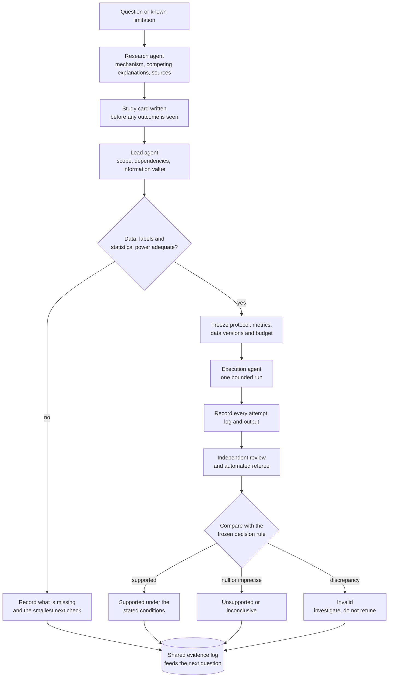

# Research plan

This document describes how new experiments are proposed, tested and reported in Filing Time
Machine, what it would take to close the gaps listed in the [README](../README.md#caveats), three
new study ideas, and candidate data sources. The new studies and source proposals remain plans;
completed measurement checks and audits are labelled below. No new data source has been adopted.

## How an idea becomes a result

The project is developed with a small team of AI agents that each play one role: a research agent
proposes ideas and checks the literature, a lead agent scopes them, and an execution agent writes
the code and runs approved jobs. The workflow below is designed so that adding agents produces
better-documented answers, not more chances to find a lucky backtest.



Three rules keep the workflow honest:

- **Outcomes come last.** A study card fixes the question, data, measurement, baseline, test and
  budget before anyone looks at results. If any of these is undecided, the study does not run.
- **Nothing is deleted.** Return-hypothesis trials, including failed and null runs, are appended
  to the [trial ledger](../results/trial_ledger.jsonl) and count toward their multiple-testing
  family. Component measurements and audits keep separate receipts; they do not silently change
  the return-trial denominator.
- **Three separate verdicts.** Whether a job *ran*, what it *showed scientifically* (supported,
  unsupported, inconclusive or invalid) and whether it is *ready to publish* are tracked separately.
  A completed run can still be invalid evidence.

### What every study card must specify

| Field | Example of what it pins down |
|---|---|
| Question | Mechanism, expected direction, unit of analysis, what the study does *not* claim, and what would falsify it |
| Information set | Data versions, security identifiers, availability clocks and exact time windows |
| Measurement | Feature definition, units, how missing or unknown values are handled, and how labels were validated |
| Comparison | A cheap baseline, the smallest economically meaningful effect, and costs |
| Inference | Unit of dependence, number of independent periods, the test and threshold, and multiple-testing family |
| Execution | Code and environment versions, seed, output schema, and CPU/memory/time limits |
| Prior exposure | Which data has already been looked at, and why the proposed split is still clean |

### Running experiments in isolation

Today the agents share one machine and one repository, with one designated agent writing code and
running jobs.
The planned next step is to run each experiment in a disposable container that has read-only
access to a checksum-pinned data snapshot, no network access, no access to the sealed holdout or
any credentials, and hard CPU/memory/time limits. Before relying on it, the container would be
tested by deliberately trying to read a protected file, reach the network and query data past the
cutoff, and confirming that each attempt fails.

The [offline request/permit checks](DATA_AUDIT.md#offline-cost-run-contract-and-measurement-fixes)
now validate supplied scope, hashes, completed prerequisites, expiry and budgets,
with synthetic failure/null receipts. They do **not** authenticate permissions,
launch workers or enforce host isolation. The planned container remains unprovisioned.

## Closing the known gaps

| Gap | First step | What "done" looks like |
|---|---|---|
| Filing timestamps | Use the [staged authority plan](../results/timestamp_authority_plan.json): qualify field clocks and filing roles, then a bounded metadata pilot including agreeing sources, before cohort-wide header checks | A per-filing table of verified times, with counts of assignments that actually changed and any filings left unresolved |
| Survivorship and identity | Compare data sources on a fixed panel of continuing, merged, delisted and renamed companies | Dated security identities, corporate actions and delisting payoffs that reconcile case by case |
| Real measurement labels | Two people independently label claim changes in 60 real filing pairs, with disagreements adjudicated | Measured precision and recall of claim extraction on real text, not synthetic benchmarks |
| Cheap baselines | Compare simple text-edit, TF-IDF, embedding and rule-based claim matching on the same labelled pairs | Evidence of whether the LLM adds anything beyond simple methods |
| Claim-level signal (H1) | Register the exact comparison, data, effect size and test | One evaluation, reported whatever the outcome |
| More independent periods | Plan a separate older-period study with survivorship-free data | More real, independent months; nominal date ranges alone do not count |
| Model training | Train a small claim matcher only if the labelled audit shows errors it could fix | Splits separated by time and by company, compared against the frozen baselines |
| Trading costs | Record which cost components are observed and which are assumed; compute break-even costs | A realistic net comparison, plus a long-only version that needs no borrowing |

A fine-tuned modern model is not automatically free of look-ahead for old filings, even if its
fine-tuning data is old, because its pretraining may include later text. Measurement models are
trained to read filings correctly, never to predict historical returns.

## Three new study ideas

These are proposals only. Each would need its own study card and must clear the gaps above before
any return is examined.

### Does attention speed up how fast disclosures are priced?

- **Question:** when a company's filing contains meaningful changes, are they priced faster if the
  topics it discusses are already getting heavy news coverage?
- **Mechanism:** investor attention is limited; coverage may reduce the delay before information is
  reflected in prices.
- **Competing explanations:** coverage that follows earlier price moves, sector-wide news, the
  severity of the disclosure itself, and syndicated duplicate stories.
- **Data:** news-volume metadata from [GDELT](https://www.gdeltproject.org/) or official feeds,
  matched to topics already present in earlier filings, plus prices and factors. Publication,
  first-seen and ingestion times are kept separate.
- **Test:** disclosure-only and attention-only baselines against their interaction, measured over
  pre-set early and late return windows.
- **What would falsify it:** coverage that simply tracks past returns, no gain over the baselines,
  or placebo topics working just as well.

### When the story improves but the numbers don't

- **Question:** when management's specific claims become more positive while the accounts already
  known at the time deteriorate, do later fundamentals confirm the story, or is it just disclosure
  style?
- **Mechanism:** delayed recognition or selective framing. Alternatives include genuine turnarounds,
  cyclical businesses, template edits and accounting measurement error. An association would not be
  evidence of misconduct.
- **Data:** report pairs with claims tied to quoted text, and accounting values as first reported,
  with unknown values kept as unknown.
- **Test:** first a measurement-only audit of the divergence indicator; later, separately
  registered, its association with next-year fundamentals against accounting-only and text-only
  baselines.
- **What would falsify it:** the divergence disappears once units and first-reported values are
  corrected, or it is driven by boilerplate.

### Customer shocks travelling to suppliers

- **Question:** when a customer suffers a shock, do suppliers whose relationship was disclosed
  *before* the shock react with a delay, beyond their own news and sector moves? This extends
  hypotheses H2 and H3.
- **Mechanism:** investors may not trace economic links between companies quickly.
- **Data:** customer-supplier links grounded in earlier filings, with dated security identities for
  both companies.
- **Test:** linked suppliers against matched unlinked firms and randomly rewired networks.
- **What would falsify it:** links discovered only later predict just as well, the effect vanishes
  after sector controls, or reversed link direction works equally well.

## Data sources

Survivorship-free historical prices are the single biggest constraint. The project currently uses
free public sources only. Prices below are as listed on the providers' public pages on
2026-11-14; every option's licence must be checked before publishing results derived from it.

### Free and public

| Source | Useful for | Caveat |
|---|---|---|
| [SEC EDGAR](https://www.sec.gov/search-filings/edgar-application-programming-interfaces) | Filings, headers, accounting facts, acceptance times | No historical ticker or delisting-payoff master; JSON acceptance times need header verification |
| [GDELT](https://www.gdeltproject.org/) | News attention and event metadata | Its `DATEADDED` field is when an event entered the database, not when the article was published |
| [Federal Reserve feeds](https://www.federalreserve.gov/feeds/feeds.htm) | Scheduled policy-event times | Rolling feeds do not preserve history or corrections |
| [ALFRED](https://alfred.stlouisfed.org/) | Macro data as it was known on each date | Needs an API key; its API terms restrict caching and use for model training |

### Paid or request-based

| Source | What it offers | Main limitation |
|---|---|---|
| [Norgate Data](https://norgatedata.com/stockmarketpackages.php) US Platinum | Advertises delisted securities, history back to 1990 and historical index membership; about $347 for 6 months or $630 a year | Personal use only, and data must be deleted when the subscription ends; delisting payoffs need checking |
| [EODHD](https://eodhd.com/pricing) | Low-cost API, about $20 a month for historical end-of-day prices | Delisted coverage before 2018 is end-of-day prices only |
| [Sharadar](https://data.nasdaq.com/publishers/SHARADAR) via Nasdaq Data Link | Prices and fundamentals with permanent security identifiers | Personal-use terms restrict publishing evaluations of the data |
| [CRSP](https://indexes.morningstar.com/research-data-products/crsp-us-stock-databases) | The academic standard: active and inactive securities, permanent identifiers, corporate actions | Institutional subscription; individual access is by request |
| [Compustat Point-in-Time](https://www.marketplace.spglobal.com/en/datasets/compustat-financials-%288%29) | Accounting values as originally reported, not later revised | Separate product from ordinary Compustat; by quote |

### Dataset platforms

[Mozilla Data Collective](https://mozilladatacollective.com/datasets),
[Hugging Face](https://huggingface.co/datasets) and [Kaggle](https://www.kaggle.com/datasets) are
useful for finding labelled text for measurement work. Each dataset carries its own licence: for
example, [Financial PhraseBank](https://huggingface.co/datasets/takala/financial_phrasebank) is
CC BY-NC-SA 3.0, which rules out commercial use. None of the platforms offered a survivorship-free,
point-in-time equity panel, and a generic finance sentiment dataset is not a substitute for labelled
pairs of company disclosures.

## Free benchmarks for testing measurement on real data

The project's extraction benchmark uses synthetic labels. Before testing new return signals, the
cheapest real check is whether the measurement tools read financial documents correctly. Several
free, human-annotated benchmarks can test that. TAT-QA and FinQA have been used so far; the
results follow the table.

| Benchmark | What it labels | How it is scored | Watch out for |
|---|---|---|---|
| [TAT-QA](https://github.com/NExTplusplus/TAT-QA) ([paper](https://aclanthology.org/2021.acl-long.254/)) | 16,552 questions over tables and text from 182 annual reports, written by financially trained annotators and checked by two verifiers | Exact match and F1, including scale, units and arithmetic | Splits are random, not by company or date; data is CC BY 4.0 |
| [FinQA](https://github.com/czyssrs/FinQA) ([paper](https://arxiv.org/abs/2109.00122)) | 8,281 expert-written questions with the facts and the calculation that answers each one, from 1999-2019 reports | Execution accuracy of the calculation | Use the corrected preprocessing: the authors disclosed and corrected a label-leak bug in 2022 |
| [FinDVer](https://github.com/yilunzhao/FinDVer) ([paper](https://arxiv.org/abs/2411.05764)) | 2,400 true-or-false financial claims with supporting evidence, from early-2024 filings | Balanced accuracy and macro-F1, plus whether the cited evidence is right | Recent documents may already be in a modern model's training data |
| [FinanceBench](https://huggingface.co/datasets/PatronusAI/financebench) ([paper](https://arxiv.org/abs/2311.11944)) | 150 public question-answer pairs with evidence (the full set is gated) | Answer correctness and refusal rate | Non-commercial licence (CC BY-NC 4.0) and a small sample |
| [FinCausal 2020](https://github.com/yseop/YseopLab/tree/develop/FNP_2020_FinCausal) ([paper](https://arxiv.org/abs/2012.02505)) | Cause-and-effect spans in 2019 financial news | Weighted precision, recall and F1 | Linguistic cause and effect is not economic causation |
| [ConvFinQA](https://github.com/czyssrs/ConvFinQA) ([paper](https://arxiv.org/abs/2210.03849)) | 3,892 multi-turn conversations built on FinQA | Turn-level and conversation-level accuracy | Derived from FinQA, so not an independent check; its test answers are held back |

### What has been run

Each test drew its questions at random. The questions, prompt and scoring were committed before any
answer was produced, and every attempt was kept, including ones that stopped early. Benchmark files
stay local. The linked records hold file versions, checksums and each question's outcome by ID,
without question or answer text. Before any file was opened, its public history was checked against
the project's sealed test period. TAT-QA's development file has not changed since May 2021, and
every FinQA report ID names a year from 2001 to 2019.

| Test | Reader | Questions | Outcome | Record |
|---|---|---|---|---|
| Rule baseline | Hand-written lookup and arithmetic rules | 30 TAT-QA | 5 right, 4 wrong, 21 declined | [results](../results/benchmark_diagnostic_status.json) |
| Rule baseline | Same rules | 10 FinQA | All 10 declined | [results](../results/benchmark_followup_status.json) |
| Averaging fix | Rules before and after fixing three averaging errors | 30 new TAT-QA | Both versions 3 right; no question used the fixed rule | [results](../results/benchmark_followup_status.json) |
| First model run | Qwen 3.5 4B on a local CPU | 10 new TAT-QA | All 8 finished requests declined; stopped on a timeout | [results](../results/reader_diagnostic_status.json) |
| Can it answer at all? | Same model, asked for the answer before the option to decline | 12 invented questions | 9 of 10 answerable right, both unanswerable declined (old prompt: 1 of 10) | [results](../results/reader_pc1_status.json) |
| Second model run | Same | 30 new TAT-QA | Stopped by an over-sensitive CPU safeguard before any answer | [results](../results/reader_real1_status.json) |
| Final model run | Same | 30 new TAT-QA | 11 right with the report, none without | [results](../results/reader_real2_combined.json) |

### The final model run

| All 30 questions | Report supplied | No report |
|---|---:|---:|
| Exact match / F1 | 36.7% / 42.6% | 0% / 0% |
| Exact-match 95% range | 21.9-54.5% | 0-11.4% |
| Units right | 73.3% | 0% |
| Answered | 100% | 0% |
| Right / wrong / declined | 11 / 19 / 0 | 0 / 0 / 30 |

With the report, the model got 7 of 10 single-value lookups exactly right, 4 of 15 calculations,
none of the 4 questions needing several values, and the single counting question wrong.

- **Answers occurred in the report-supplied condition.** Without the report the
  model declined every question (exact McNemar p = 0.001, descriptive only).
  This contrast does not identify whether its knowledge also came from pretraining.
- **The run was completed, not restarted.** It first stopped after 10 question pairs, when the
  model's memory use passed a 6 GiB limit. The limit was raised to 10 GiB with nothing else
  changed, and only the unfinished questions were run. The
  [as-stopped result](../results/reader_real2_status.json) and the
  [completion](../results/reader_real2_completion_status.json) are both kept.
- **It is cheap to run.** The completion took 8.7 minutes on 4 CPU threads, using about 8 GiB of
  memory.

For scale, the TAT-QA paper reports human experts at
[84.1% exact match](https://arxiv.org/html/2105.07624v2#S4.T3) on its own test set; that is not a
matched comparison.

**What this does not show.** Thirty questions leave a wide range (22-54%), and questions about the
same report are not independent. The model may have seen this public benchmark during training, and
declining without the report does not rule that out. Answering questions about one report is not the
same as measuring how claims change between filings. None of this shows the signal would have been
usable at the time, and it says nothing about returns.

### Offline review of the nineteen misses

The [post-run audit](../results/reader_error_audit.json) reviewed all nineteen saved
errors without a model call or rescoring. Four multi-answer responses contain the
reference components but serialize them as one string; two other misses have the
reference value component with the wrong unit. Six primary observations are numeric
result mismatches. Other categories cover operator/denominator conventions,
period comparison, cited operands and reference-span boundaries.

Flags overlap: seven wrong cases have reference-scale mismatches, seven cite the
wrong row/period/header cells despite valid coordinates, and four provide no
citation. Five need independent span/operator adjudication. This is AI-assisted,
post-hoc review, not blinded human gold. The published 11/30 result is unchanged.
The next generic development checks should address multi-answer shape, typed
row/period/unit operands and deterministic calculation; no fix or new model run
was made by this audit.

The subsequent [frozen invented test](../results/reader_contract_config.json) tried
those ideas on 24 newly written fictional questions, not the exposed benchmark.
It [failed](../results/reader_contract_review.json): 0/21 answerable cases passed
the complete answer/scale/dimension/operation contract, and only 1/3 unanswerable
cases was correctly declined. Twenty-two outputs violated cross-field rules;
no arithmetic output reached accepted code execution. Values were often present,
but incompatible fields cannot be silently repaired into successes. All calls
finished normally. There was no tuning or rerun, and this says nothing new about
real-data accuracy. A simpler response interface needs a new, declared test.

Before any scored control is frozen, run a small, separately labelled practice
check for format and resource problems. Practice may be iterated but is never
reported as accuracy. Write fresh scored items only after practice, then freeze
the questions, expectations, interface and pass rule before the one scored run.

The [next interface control](../results/reader_modes_review.json) followed that sequence:
12 practice items, 40 calls across three iterations, then 24 freshly written scored
items. Practice was not accuracy. The union grammar constrained syntax but was
operationally unreliable, so the final interface chose a mode in one call and used
only that mode's fields in the next. Operand fields were bounded to the source
vocabulary; code computed arithmetic and scale while checking the model's answer
dimension. A post-generation practice-reporting error was recovered offline, with
the interrupted receipt retained and no repeated call.

| Fresh invented scored controls | Fully right |
|---|---:|
| Several values | 6/6 |
| Arithmetic | 6/8 |
| One lookup | 3/4 |
| Unit traps | 3/3 |
| Correctly declined missing/undefined answers | 0/3 |

**FAIL:** 18/21 answerable and 0/3 abstentions missed the frozen 20/21 plus 3/3 rule.
Seven arithmetic outputs were computed by code; wrong period direction, wrong
dimensions and failure to decline still matter. All responses followed the mode
schemas, but this is not reliable answerability. The fresh authored questions and
stronger constraints also prevent a matched accuracy comparison to earlier tests.
There was no tuning or rerun, no real benchmark use, and no new real-data permission.

### What the earlier tests taught

- **The first model run's refusals were deliberate.** Every saved response was a valid, explicit
  refusal, not cut-off or unparsed output ([diagnosis](../results/reader_pc1_diagnosis.json)).
  Asking for the answer before the option to decline fixed it on invented questions. The prompt
  wording and the field order changed together, so the test can't say which mattered.
- **One fix can hide behind another.** The rule baseline's three wrong averages came from three
  different mistakes: a skipped middle year, a unit label further down the table, and
  "weighted-average" read as an instruction. No new question triggered the fixed rule, so it shows
  no real-data benefit.
- **Safeguards need headroom.** One run stopped on brief CPU spikes from other programs, another
  on a memory limit set just below what the model needs. Both stops are recorded rather than
  quietly retried.

The software checks need no model or benchmark files:

```powershell
python -m pytest -q tests\test_benchmark_baseline.py tests\test_reader_positive_control.py tests\test_reader_real2.py tests\test_reader_completion.py
```

### Three measurement ideas worth testing

| Idea | What it compares | Cheapest first check |
|---|---|---|
| Claims that keep their history | Plain retrieval against claims that track which filings support them and drop out when a later filing withdraws or corrects them | Synthetic sequences of repeated, corrected and withdrawn claims, then real labelled disclosures |
| Arithmetic that shows its work | A bare numeric answer against one that names each operand's company, period, unit and source | A deterministic checker on TAT-QA and FinQA labels, reporting how often it abstains |
| Taking the evidence away | Answers with the correct evidence against answers with that evidence removed, replaced, or swapped for the wrong year | First confirm the control truly lacks another valid source; an unchanged answer suggests the model isn't grounded, but doesn't prove it memorised |

### Still missing for return tests

No free source found so far provides a complete, survivorship-free history of US stocks with
delisting payoffs. Current exchange symbol directories describe today's listings only, and free
brokerage market-data APIs need an account and don't document full delisting and merger payoffs.
Free measurement benchmarks can improve how filings are read, but they can't fix the return sample,
the timestamp checks, trading costs or the sample-size limits described in the README.

## Testing the workflow itself

Whether a team of agents does better research than a single agent is itself a testable question.
A fair comparison would give both the same tools, data and total compute; run them on
method and measurement tasks that involve no market outcomes; and score them blind on time to a
well-specified study, defects caught before evaluation, reproducibility, and how faithfully null
results are reported. The number of statistically significant strategies found would be a bad
metric, because it rewards searching until something works.
