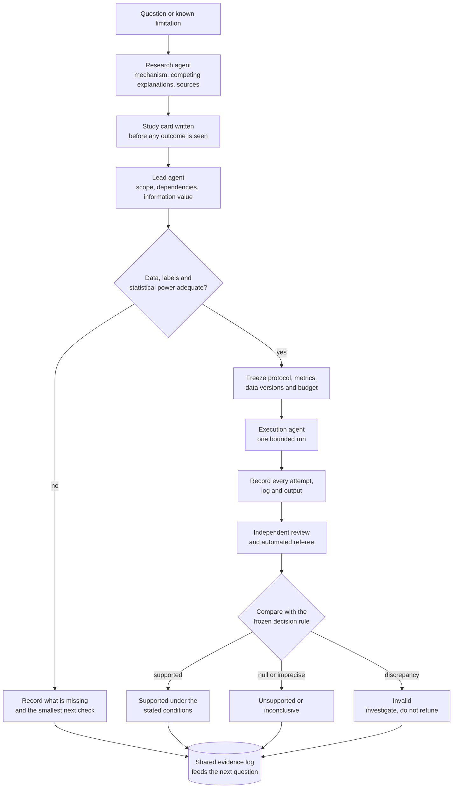

# Research plan

This plan covers how a new experiment is proposed, run and reported; what it would take to close
the gaps listed in the [README](../README.md#caveats); three new study ideas; and candidate data
sources and benchmarks. Everything below is a proposal unless it links to a recorded result. No new
data source has been adopted, and nothing here registers a study, authorizes spending or opens a
holdout. The full working notes, including approval chronology, are in the
[archived version](https://github.com/nicholas-yi/chronoledger/blob/archive-2026-11/docs/RESEARCH_PLAN.md).

## Literature-backed priorities

The [2026-11-17 research review](https://github.com/nicholas-yi/chronoledger/blob/archive-2026-11/docs/RESEARCH_REVIEW_2026_11.md)
ties recent financial NLP and econometrics to the project's recorded failures. Its priorities are:

1. Evidence-localized, real paired-claim measurement.
2. Correcting model measurement errors with a validation sample.
3. Prospectively frozen finite-population audits that account for unread cases.
4. Inference and power designed around economically meaningful effects.

The [quant research frontiers review](https://github.com/nicholas-yi/chronoledger/blob/archive-2026-11/docs/QUANT_RESEARCH_FRONTIERS_2026_11.md)
adds mechanism-first proposals; the [offline quant toolkit](OFFLINE_QUANT_TOOLKIT.md) implements
reference algorithms for its nine directions, checked on invented fixtures only. Earlier
KPI-omission screens are quarantined or closed without a finding
([archived detail](https://github.com/nicholas-yi/chronoledger/blob/archive-2026-11/docs/RESEARCH_PLAN.md#literature-backed-upgrade-priorities)).

## How an idea becomes a result

The project is developed by a small team of AI agents with one role each: a research agent proposes
ideas and checks the literature, a lead agent scopes them, and an execution agent writes the code
and runs approved jobs. The workflow is designed so that more agents produce better-documented
answers, not more chances to find a lucky backtest.

Three rules keep the workflow honest:

- **Outcomes come last.** A study card fixes the question, data, measurement, baseline, test and
  budget before anyone looks at results. If any of these is undecided, the study does not run.
- **Nothing is deleted.** Every return-hypothesis trial, including failed and null runs, is
  appended to the [trial ledger](../results/trial_ledger.jsonl) and counts toward its
  multiple-testing family. Component measurements and audits keep separate receipts and do not
  change the return-trial denominator.
- **Three separate verdicts.** Whether a job *ran*, what it *showed* (supported, unsupported,
  inconclusive or invalid) and whether it is *ready to publish* are tracked separately. A completed
  run can still be invalid evidence.

### What every study card must specify

| Field | What it pins down |
|---|---|
| Question | Mechanism, expected direction, unit of analysis, what is *not* claimed, and what would falsify it |
| Information set | Data versions, security identifiers, availability clocks and exact time windows |
| Measurement | Feature definition, units, handling of missing or unknown values, and label validation |
| Comparison | A cheap baseline, the smallest economically meaningful effect, and costs |
| Inference | Unit of dependence, number of independent periods, test and threshold, multiple-testing family |
| Execution | Code and environment versions, seed, output schema, and CPU/memory/time limits |
| Prior exposure | Which data has already been seen, and why the proposed split is still clean |

### Running experiments in isolation

Today the agents share one machine and repository, and one designated agent writes code and runs
jobs. The next step is a disposable container per experiment: read-only access to a
checksum-pinned data snapshot, no network, no holdout or credentials, and hard CPU/memory/time
limits. Before relying on it, deliberately try to read a protected file, reach the network and query
past the cutoff, and confirm each attempt fails. The existing
[offline request/permit checks](https://github.com/nicholas-yi/chronoledger/blob/archive-2026-11/docs/DATA_AUDIT.md#offline-cost-run-contract-and-measurement-fixes)
validate scope, hashes, prerequisites, expiry and budgets, but do not enforce host isolation; the
container is not yet provisioned.

## Closing the known gaps

The [closure review](../results/project_closure_review.json) records what software can close and
what still needs data, people or a new design. None of these steps creates a trading result.

| Gap | Status | What would close it |
|---|---|---|
| Filing timestamps (H0) | **Closed.** [A4](../results/timestamp_full_a4_report_r2.json) qualified all 16,921 timing-sensitive H0 accessions and resolved all 404 identity disagreements; five MHLA filings were stored 4-5 hours early. [D16](DEVIATIONS.md#d16-replace-h0-knowledge-times-with-qualified-acceptance-times) replaced every audited H0 time and reran H0; the conclusions did not change | Nothing further for H0 |
| Filing timestamps (H4/H6a, 2012-2018) | [A5](../results/timestamp_a5_report.json): 0 of 262 qualify under the frozen rule; a labelled [post-hoc Eastern reading](../results/timestamp_a5_posthoc_sensitivity.json) changes no H4/H6a assignment | Header verification of any older bulk times a future return test uses |
| Inference calibration (F10) | **Permanent limit of this design.** With T=17/18 development months and about 28 in the holdout, every monthly procedure tested fails the frozen 5% size rule ([F10](FINDINGS.md#f10-status-a-permanent-limit-of-this-design-2026-11-20)). Monthly t-statistics are descriptive | A new study with more independent months, registered before its data are examined |
| Survivorship and identity (F2) | H5b, H5c and H6b are **invalid** under current-ticker prices ([F2](FINDINGS.md#f2-distress-event-tests-are-invalid-under-a-current-ticker-universe)). The cheapest credible fix found is Sharadar (~$39 for one month); the owner declined paid survivorship-free data on 2026-11-21 | Dated security identities, corporate actions and delisting payoffs that reconcile case by case, if paid data is ever approved |
| H4/H6a holdout (D18) | The exposed 2022-2025 windows are retired as confirmatory evidence. [D18](DEVIATIONS.md#d18-move-h4-and-h6a-confirmatory-evaluation-to-a-prospective-holdout) uses filings accepted 2026-11-22 to 2027-11-21, evaluated once: H6a not before 2028-12-31, H4 not before 2029-03-31 ([periods.py](../src/asof/periods.py) enforces the dates) | One evaluation after those dates, with unchanged samples, tests and thresholds |
| Social sentiment (H7) | **Closed unregistered.** The candidate scorer failed qualification ([receipt](../results/sentiment_scorer_validation.json)) and the owner declined spending on model or social-media access | None planned; there is no H7 result |
| Real measurement labels | No labels exist. Recruit two annotators and an adjudicator, using the [draft guide](H1_DESIGN.md#annotation-guide-h1-claim-guide-draft-01) and [empty first-pass template](h1_annotation_first_pass_template.csv) | Measured precision and recall on real text, with coverage, agreement and company-separated audit results |
| Cheap baselines | Compare text-edit, TF-IDF, embedding and rule-based claim matching on the same labelled pairs | Evidence of whether the LLM adds anything beyond simple methods |
| Claim-level signal (H1) | [Draft measurement-first design](H1_DESIGN.md); see below | One valid comparison, reported whatever the outcome |
| Model training | Train a small claim matcher only if the labelled audit shows errors it could fix | Splits separated by time and company, compared against frozen baselines |
| Trading costs | Record which cost components are observed and which are assumed; compute break-even costs | A realistic net comparison, plus a long-only version that needs no borrowing |

A fine-tuned modern model is not automatically free of look-ahead for old filings: its pretraining
may include later text even if its fine-tuning data is old. Measurement models are trained to read
filings correctly, never to predict historical returns. Timestamp-audit chronology (A1-A3, request
budgets, gateway stops) is in the
[archived gap section](https://github.com/nicholas-yi/chronoledger/blob/archive-2026-11/docs/RESEARCH_PLAN.md#closing-the-known-gaps).

## Claim-level test (H1)

The [draft H1 design](H1_DESIGN.md) starts with human labels, not returns:

- **Labels first.** Two people independently label real filing pairs, followed by human
  adjudication; AI suggestions cannot replace their blind first pass. They have not been recruited.
- **Measurement before returns.** Check whether claims, matches and changes are faithful to the
  source, against simple baselines.
- **Power.** The existing 17-18-month sample cannot support a confirmatory return test with any
  method calibrated so far. Even optimistic calculations need effects around 0.7-1.0 monthly
  residual standard deviations for 80% power (a scale illustration, not a calibrated minimum
  detectable effect).
- **Then, separately specified,** a comparison of claim-level change against word-level change.

The [decision packet](../results/research_decision_packet.json) lists the unsent questions and
inputs still needed. An offline intake command validates annotation and source-receipt drafts
structurally; it is a gate to human review, not accepted gold or source clearance
([archived usage](https://github.com/nicholas-yi/chronoledger/blob/archive-2026-11/docs/RESEARCH_PLAN.md#preparing-reviewable-inputs-without-inventing-evidence)).

## Three new study ideas

Each would need its own study card and must clear the gaps above before any return is examined.

| Idea | Question and mechanism | Data and test | What would falsify it |
|---|---|---|---|
| Attention and pricing speed | Are meaningful filing changes priced faster when their topics already get heavy news coverage? Investor attention is limited | News-volume metadata from [GDELT](https://www.gdeltproject.org/) or official feeds, matched to topics in earlier filings, keeping publication, first-seen and ingestion times separate. Disclosure-only and attention-only baselines against their interaction, over pre-set early and late windows | Coverage that just tracks past returns, no gain over baselines, or placebo topics working as well |
| Story improves, numbers don't | When management's claims turn more positive while known accounts deteriorate, do later fundamentals confirm the story? Alternatives: genuine turnarounds, cyclicality, template edits, measurement error. An association is not evidence of misconduct | Claims tied to quoted text and first-reported accounting values, unknowns kept unknown. First a measurement-only audit; later, separately registered, association with next-year fundamentals against accounting-only and text-only baselines | The divergence disappears once units and first-reported values are corrected, or is driven by boilerplate |
| Customer shocks to suppliers | Do suppliers whose link was disclosed *before* a customer shock react with a delay, beyond their own news and sector moves? Extends H2 and H3 | Links grounded in earlier filings, with dated identities for both firms. Linked suppliers against matched unlinked firms and randomly rewired networks | Links discovered only later predict as well, sector controls remove the effect, or reversed links work equally well |

## Data sources

Survivorship-free historical prices are the biggest constraint. The project uses free public
sources only.

### Free and public

| Source | Useful for | Caveat |
|---|---|---|
| [SEC EDGAR](https://www.sec.gov/search-filings/edgar-application-programming-interfaces) | Filings, headers, accounting facts, acceptance times | No historical ticker or delisting-payoff master; JSON acceptance times need header verification |
| [GDELT](https://www.gdeltproject.org/) | News attention and event metadata | `DATEADDED` is when an event entered the database, not when the article was published |
| [Federal Reserve feeds](https://www.federalreserve.gov/feeds/feeds.htm) | Scheduled policy-event times | Rolling feeds do not preserve history or corrections |
| [ALFRED](https://alfred.stlouisfed.org/) | Macro data as known on each date | Needs an API key; terms restrict caching and use for model training |

Dataset platforms ([Hugging Face](https://huggingface.co/datasets), [Kaggle](https://www.kaggle.com/datasets),
[Mozilla Data Collective](https://mozilladatacollective.com/datasets)) help find labelled text for
measurement work, under each dataset's own licence. None offered a survivorship-free,
point-in-time equity panel.

### Historical-equity source comparison (draft)

This records Research's public-document review as of 2026-11-16. **No data was purchased or
acquired, and no source is qualified** against the [12-case panel](../results/price_source_test_panel.json).
Prices and terms can change. Keeping a delisted price history is not the same as supplying the
shareholder's terminal wealth. Per-source evidence labels and links are in the
[archived table](https://github.com/nicholas-yi/chronoledger/blob/archive-2026-11/docs/RESEARCH_PLAN.md#historical-equity-source-comparison-draft).

| Source | What it offers | Price | Key rights limit |
|---|---|---|---|
| Yahoo-type free | Quotes, dividends and splits; inactive and terminal-payoff coverage unknown | CSV download behind Gold | Browsing is not a research redistribution licence |
| Stooq-type free | Historical bars; identity and corporate-action lineage unknown | Free downloads advertised | Free availability is not an open-data licence |
| Tiingo | Raw/adjusted prices with split/dividend/listing-change cleaning | Not reliably pinned; some account exceptions from $250/month | Free/Starter/trials cannot persist data or derived outputs; paid data deleted at expiry |
| Alpha Vantage | Active/delisted listing status after 2010-01-01 | Free 25 requests/day; full history premium | Retention/redistribution rights unknown |
| Nasdaq/NYSE status lists | Current operational directories and pending delistings | Free to read | Cannot reconstruct a point-in-time universe |
| SEC-derived overlay | Legal events, cancellation and consideration, case by case | Free, but substantial work | Not a price database |
| Norgate Platinum/Diamond | Inactive/OTC history, stable `assetid`, dated index membership; **no** terminal return or merger terms | $346.50/six months or $630/year; trial covers only the latest two years | Personal use; data deleted after lapse |
| EODHD | Inactive symbols and US symbol changes; pre-2018 delistings have EOD only | EOD $19.99/month, fundamentals $59.99, all-data $99.99 | Multi-person or distribution use can need a commercial licence |
| Sharadar | Inactive history around 1998+, `permaticker`, dated actions, cash plus stock consideration, as-reported fundamentals; **CVRs excluded** | Prices from $9/month; full history $39/month or $299/year | Section 8 requires prior written approval to publish data evaluations; data deleted within 30 days after termination |
| Polygon/Massive | Inactive records and bars, including OTC; symbol changes | Starter $29, Developer $79, Advanced $199/month | Individual access is not redistribution permission |
| Databento | Point-in-time security master from 2005+; actions only from 2018-05-01 | $299/month at launch, not a current quote | Needs a contract |
| Intrinio | 50+ years of raw/adjusted prices; inactive coverage unknown | From $150/month Individual | Rights unknown |
| FirstRate | 2000+, 7,000+ delisted, OTC venues; identities and payoffs unknown | Updates $59.95/month, or $79 with fundamentals | Perpetual storage and public research with attribution; no raw redistribution |
| CRSP | Permanent PERMNO/PERMCO and delisting returns: the strongest documented complete-return design | Institutional entitlement | Contractual; not transferable between institutions |
| Compustat | Financials, identifiers and point-in-time snapshots | Institutional/contracted | Redistribution/retention unknown |

**Proposed choice, if paid data is ever approved.** Sharadar full-history prices and actions is the
primary small-budget candidate, conditional on entitlement and section 8. EODHD is the cheap
price-only fallback, with identities and payoffs evidenced separately. A one-provider
complete-return source means CRSP through a legitimate entitlement. Any sample would start with
rights, freeze the 12 cases, cap endpoints at 2024-07-31, reconcile every payoff leg without double
counting, and stop on any rights, identity, payoff or clock failure. The panel has no CVR case. The
[archived acceptance contract](https://github.com/nicholas-yi/chronoledger/blob/archive-2026-11/docs/RESEARCH_PLAN.md#proposed-sample-acceptance-contract)
has the full steps.

## Free benchmarks for testing measurement on real data

Before testing new return signals, the cheapest real check is whether the measurement tools read
financial documents correctly. These free, human-annotated benchmarks can test that:

| Benchmark | What it labels | Watch out for |
|---|---|---|
| [TAT-QA](https://github.com/NExTplusplus/TAT-QA) | 16,552 questions over tables and text from 182 annual reports; exact match and F1 | Random splits, not by company or date; CC BY 4.0 |
| [FinQA](https://github.com/czyssrs/FinQA) | 8,281 expert questions with the calculation that answers each, from 1999-2019 reports | Use the corrected preprocessing after the 2022 label-leak fix |
| [FinDVer](https://github.com/yilunzhao/FinDVer) | 2,400 true-or-false financial claims with evidence, from early-2024 filings | Recent documents may be in a modern model's training data |
| [FinanceBench](https://huggingface.co/datasets/PatronusAI/financebench) | 150 public question-answer pairs with evidence | CC BY-NC 4.0 and a small sample |
| [FinCausal 2020](https://github.com/yseop/YseopLab/tree/develop/FNP_2020_FinCausal) | Cause-and-effect spans in 2019 financial news | Linguistic cause is not economic causation |
| [ConvFinQA](https://github.com/czyssrs/ConvFinQA) | 3,892 multi-turn conversations built on FinQA | Not independent of FinQA; test answers held back |

TAT-QA and FinQA have been used so far. In the final model run, a local Qwen 3.5 4B reader got 11
of 30 TAT-QA questions right with the report supplied and none without it
([record](../results/reader_real2_combined.json)); thirty questions leave a wide range and say
nothing about returns. Later strict-answer-format experiments on invented questions were stopped,
and answer-first remains the reader. The run-by-run history is in the
[archived benchmark section](https://github.com/nicholas-yi/chronoledger/blob/archive-2026-11/docs/RESEARCH_PLAN.md#what-has-been-run)
and the [focused reader](FOCUSED_READER.md) describes the current reader.

### Measurement ideas worth testing

| Idea | What it compares | Cheapest first check |
|---|---|---|
| Claims that keep their history | Plain retrieval against claims that track supporting filings and drop out when withdrawn or corrected | Synthetic sequences of repeated, corrected and withdrawn claims, then real labelled disclosures |
| Arithmetic that shows its work | A bare numeric answer against one naming each operand's company, period, unit and source | A deterministic checker on TAT-QA and FinQA labels, reporting how often it abstains |
| Taking the evidence away | Answers with the correct evidence against evidence removed, replaced or from the wrong year | First confirm the control truly lacks another valid source |

Free benchmarks can improve how filings are read, but cannot fix the return sample, timestamps,
trading costs or sample-size limits. No free source found provides a complete, survivorship-free
history of US stocks with delisting payoffs.

## Testing the workflow itself

Whether a team of agents does better research than a single agent is itself testable. A fair
comparison gives both the same tools, data and total compute; runs them on method and measurement
tasks with no market outcomes; and scores them blind on time to a well-specified study, defects
caught before evaluation, reproducibility, and how faithfully null results are reported. The number
of statistically significant strategies found would be a bad metric, because it rewards searching
until something works.
